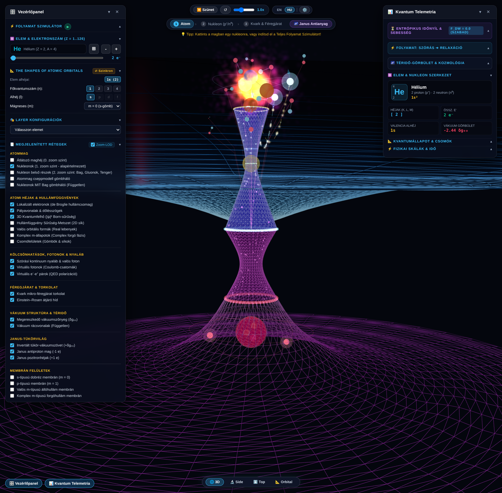
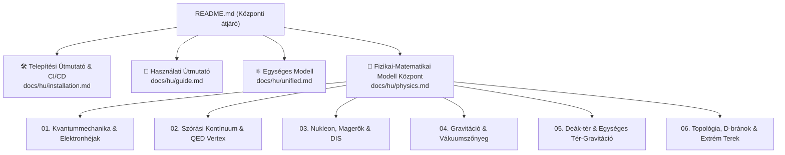

# Univerzális Kvantum- és Atomvizualizációs Rendszer

<div align="center">

[](#)
[](README.en.md)
[](https://github.com/LowCoders/atom-visualisation/actions/workflows/deploy.yml)
[](https://threejs.org/)
[](https://vitejs.dev/)

**Interaktív 3D WebGL szimulációs rendszer: elektronhéjak, szórási folyamatok, nukleon és kvark belső struktúra, valamint a téridő vákuum-megereszkedése.**

[🌐 Online Dokumentáció](https://lowcoders.github.io/atom-visualisation/) · [⚛️ 3D Szimulátor](https://lowcoders.github.io/atom-visualisation/app/) · [📖 Használati Útmutató](docs/hu/guide.md) · [📐 Fizikai Modell](docs/hu/physics.md) · [🛠️ Telepítés](docs/hu/installation.md)

<br/>

> **⚠️ Figyelem / Tudományos Nyilatkozat:**  
> Ez a projekt egy **gondolatindító, vázlatos vizualizáció**, amely egy fejlettebb projekt előkészítésének első lépése.  
> **Sem az itt leírtakat, sem pedig az animációt nem lehet helyes, fizikailag elfogadott modellként kezelni.**  
> A vizualizáció és a kapcsolódó leírások hipotetikus és didaktikai jellegűek, pedagógiai képi eszközöket alkalmaznak, és nem minősülnek kísérletileg igazolt tankönyvi fizikának.

<br/>



*3D Perspektivikus Teljes Nézet (Total View): Az anyagi atommag, elektronhéjak, megereszkedő vákuumszőnyeg, az Einstein–Rosen híd kapui és a Janus antivilág invertált tükör-vákuumszövete.*

</div>

---

## 📌 A Projekt Rövid Összefoglalása

Az **Univerzális Kvantum- és Atomvizualizációs Rendszer** egy böngészőben futó, nagy teljesítményű Three.js / WebGL alapú tudományos szimuláció. A rendszer koherens hidat képez a mikroszkopikus kvantummechanika (Schrödinger-egyenlet, elektronfelhők), a szubatomos részecskefizika (nukleonok, kvarkok, SU(3) színdinamika), valamint az Általános Relativitáselmélet téridő-görbülete és a modern térelméleti Deák-sokaság között.

### Fő funkciók és modulok:

1. **Beágyazott skálahierarchia (Multi-Scale Zoom):** Folytonos átmenet a szórási kontínuumtól (10⁻⁸ m) az atomi elektronhéjakon (10⁻¹⁰ m), a nukleon hadronikus belsőjén (10⁻¹⁵ m) át a kvarkok belső Kerr-gyűrűjéig és a Planck-skáláig (ℓ<sub>P</sub> ∼ 10⁻³⁵ m).
2. **Janus Antianyag Tükörvilág (r &lt; 0):** Invertált koordinátatengely rubin-vörös antiprotonnal, ellenkező irányban keringő pozitronhéjakkal és felfelé domborodó metrikus vákuumszövettel.
3. **6 fázisú zárt folyamatszimulátor:** A külső elektron szóródásától (15,0 eV → 4,8 eV) a QED vertexen és a dipól kvantumugráson (1s → 2p<sub>z</sub>) át a nukleáris visszalökődésig és a valós Lyman-α foton (121,57 nm) spontán emissziójáig.
4. **Dinamikus vákuumszőnyeg (δg<sub>00</sub>):** A téridő görbületének valós idejű alakváltozása az atom tömeg-energia ekvivalenciája (M\* = M₀ + 10,2 eV/c²) és a fénysebességgel terjedő gravitációs hullámfront (r = ct) mentén.
5. **Kétirányú periódusos rendszer szinkronizáció:** Mengyelejev-tábla Z = 1-től Z = 36-ig automatikus vegyértékelektron- és izotóparány-számítással.

---

## 🧭 Dokumentációs Térkép és Gyorslinkek

A dokumentáció modularizált és felkészült a többnyelvű bővítésre:



### Kiemelt dokumentumok:

- 🛠️ **[Telepítési és Üzemeltetési Útmutató](docs/hu/installation.md):** Rendszerkövetelmények, helyi szerver indítása, buildelés, Docker konténerizáció, automatikus deploy szkript (`scripts/deploy.sh`) és GitHub Actions CI/CD (`.github/workflows/deploy.yml`).
- 📖 **[Használati Útmutató](docs/hu/guide.md):** 3D kamera navigáció, rétegkapcsolók, szintek közötti zoomolás, a 6 fázisú folyamatszimulátor és telemetria kezelése.
- ⚛️ **[Egységes Modell](docs/hu/unified.md):** A rendszer működésének összefoglaló elméleti és implementációs leírása zárt energiamérleggel.
- 📐 **[Fizikai-Matematikai Modell Összegző Központ](docs/hu/physics.md):** A teljes elméleti szintézis logikai csomópontja közvetlen linkekkel a 6 moduláris al-laphoz:
  - 📖 [01. Kvantummechanika, Elektronhéjak és Atomi Stabilitás](docs/hu/physics/01-kvantum-es-atom.md)
  - 📖 [02. Szórási Kontínuum, QED Vertex és Lyman-α Emisszió](docs/hu/physics/02-szoras-es-qed.md)
  - 📖 [03. Nukleon Belső, Magerők és Részecskestruktúra](docs/hu/physics/03-nukleon-es-parton.md)
  - 📖 [04. Gravitáció, Téridő-görbület és a Vákuumszőnyeg Dinamikája](docs/hu/physics/04-gravitacio-es-vakuum.md)
  - 📖 [05. A Deák-tér és az Egységes Tér-Gravitáció Elmélet](docs/hu/physics/05-deak-ter-es-egyseges-elmelet.md) *(átemelve a pedia repóból!)*
  - 📖 [06. Magasabb Dimenziók, Topológia és Különleges Jelenségek](docs/hu/physics/06-topologia-es-kulonleges-jelensegek.md)
- 🌐 **[English Documentation Hub](README.en.md):** [Installation](docs/en/installation.md) · [User Guide](docs/en/guide.md) · [Unified Model](docs/en/unified.md) · [Theoretical Hub](docs/en/physics.md).

---

## 🏷️ Episztemológiai Besorolási Rendszer

A dokumentációban és a kódban szigorúan megkülönböztetjük a különböző bizonyosságú fizikai tételeket:

- **[Standard Fizika / Elfogadott Elmélet]**: Kísérletileg bizonyított tankönyvi fizika (Schrödinger-hullámfüggvények, QED vertex, SU(3) szín-bezárás, linearizált Einstein-egyenletek, Mössbauer-effektus, Pound–Rebka vöröseltolódás).
- **[Modell-specifikus Hipotézis]**: A projekt és a pedia repo elméleti szintézise (Deák-sokaság 5D relációs skálaszálja ρ = ln(r/a₀), a Newton-állandó G mikrofizikai levezetése a kvantumos fázishibából Δθ ∼ ℓ<sub>P</sub> / λ<sub>C</sub>, és a szingularitásokat kizáró Heisenberg–Fermi kemény mag +1/r³).
- **[Szemléltető Metafora]**: 3D WebGL pedagógiai reprezentációs eszközök (kvark torkolat mint Kerr-gyűrűs átjáró, Calabi–Yau 3D vetület, arany fotonszálak, Janus antivilág).

---

## ⚡ Gyorsindítás (Fejlesztés & Futtatás)

```bash
# 1. Függőségek telepítése
npm install

# 2. Helyi fejlesztői szerver indítása (Vite)
npm run dev

# 3. Éles csomagolás
npm run build

# 4. Helyi előnézet
npm run preview
```

Automatizált deploy eszköz futtatása:

```bash
./scripts/deploy.sh --build-only
```

---

## 📄 Licenc és Hozzájárulás

A szoftver és a kapcsolódó elméleti dokumentáció a projekt belső licencelése alatt áll. Részletes információk a repozitórium gyökerében és a [pedia](../../pedia) elméleti archívumában találhatók.
