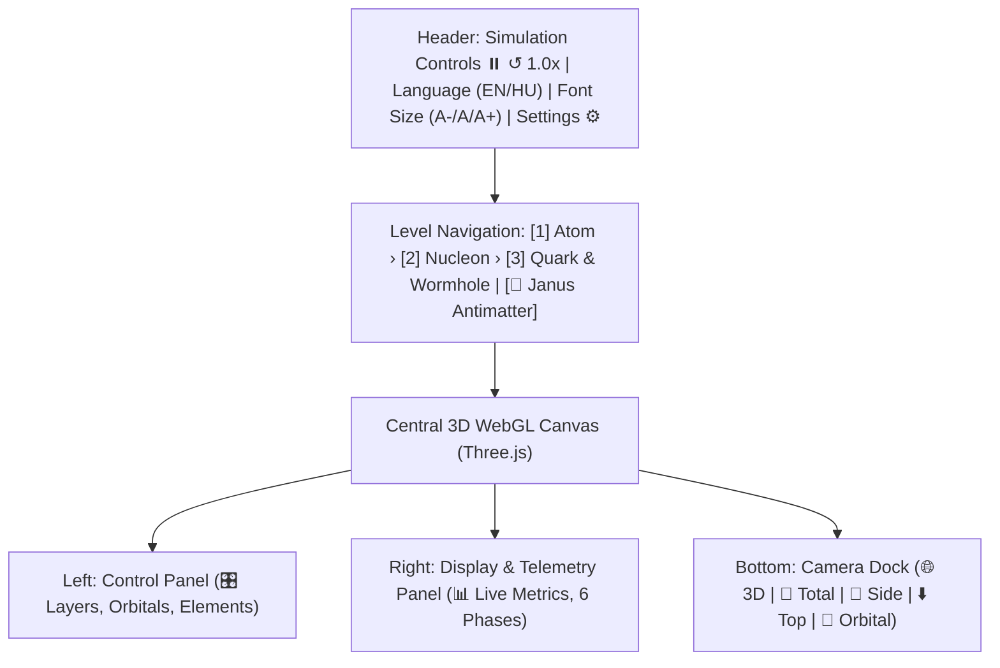
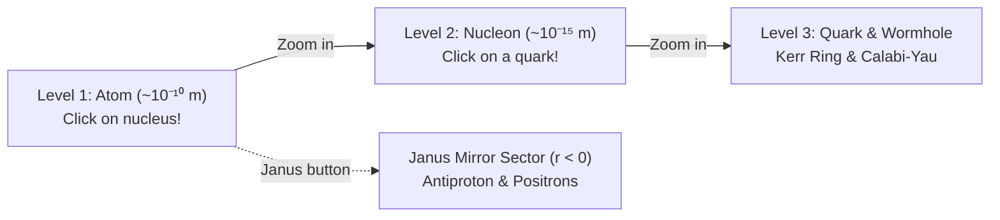

# User Guide & Navigation Manual

  <h4>⚠️ Important Scientific & Methodological Disclaimer</h4>
  

    This project is solely a <strong>thought-provoking, schematic visualization</strong> serving as the preliminary first step for preparing a more advanced project. 
    <strong>Neither the descriptions presented here nor the animation can be considered a correct, physically accepted model.</strong> 
    The visualizations and related theoretical descriptions are thought experiments and didactic tools; they do not represent an experimentally validated or canonical scientific theory.
  

This guide walks you through the interactive 3D interface, multi-scale hierarchical navigation, the 6-phase physical process simulator, and the Janus antimatter sector of the **Universal Quantum Visualisation System**.

---

## 1. Interface Overview

The interface features an ergonomic, dark glassmorphic layout:

### Key Areas:
- **Header:** Simulation playback, language toggle (`EN` / `HU`), typography scaling (`A-`, `A`, `A+`), and settings modal.
- **Level Breadcrumb Bar:** Direct switching between the three embedded observation levels and the Janus mirror world.
- **Left Control Panel:** Toggle 3D visual layers, configure quantum numbers ($n, l, m$), choose chemical elements ($Z = 1..36$), and select multi-atom lattices.
- **Right Display Panel:** Real-time physics telemetry, closed energy balance ledger, gravitational sag metrics ($\delta g_{00}$), and the 6-phase process simulator.
- **Bottom Camera Dock:** One-click presets (3D Perspective, Total View, Side View, Top-down, Orbital Plane).

---

## 2. Camera Controls & Navigation

Navigating the 3D scene uses Three.js `OrbitControls`:
- **Rotate (Orbit):** Left-click + drag / 1-finger swipe.
- **Pan:** Right-click + drag / 2-finger parallel drag.
- **Zoom:** Mouse scroll wheel / 2-finger pinch.

---

## 3. The 3 Embedded Hierarchical Levels & Janus Sector

1. **Level 1: Atom ($\sim 10^{-10}\,\mathrm{m} = 1\,\mathrm{Å}$):**
   - Central nucleus, quantum mechanical orbital probability clouds ($1s, 2p, 3d$), virtual photon energy exchange threads, and the sagging spacetime vacuum sheet.
   - Click the **nucleus** to zoom into Level 2.
2. **Level 2: Nucleon Interior ($\sim 10^{-15}\,\mathrm{m} = 1\,\mathrm{fm}$):**
   - The interior of a proton ($uud$) or neutron ($udd$).
   - Three valence quarks with rotating SU(3) color charges (RGB), Y-shaped gluon flux tubes, virtual quark-antiquark sea, and Yukawa pion filaments.
   - Click any **quark** to enter Level 3.
3. **Level 3: Quark Interior & Micro-Wormhole ($\sim 10^{-19}\,\mathrm{m} \to \ell_P$):**
   - Spinning Kerr ring singularity with ergosphere.
   - 3D projection of the 6D Calabi–Yau compact manifold.
   - **Heisenberg repulsive bounce shield** ($+1/r^3$) preventing singularity collapse.
4. **Janus Antimatter Sector ($r < 0$):**
   - Inverted coordinate metric: ruby-red antiproton, counter-revolving positrons, and upward-warping repulsive vacuum cloth.

---

## 4. The 6-Phase Dynamic Process Simulator

Experience a complete, self-consistent physical quantum cycle:
1. **Phase 0 (Idle):** Ground-state $1s$ hydrogen atom ($E = -13.6\,\mathrm{eV}$).
2. **Phase 1 (Incoming):** External free electron approaching with $E_{\text{kin}} = 15.0\,\mathrm{eV}$ along a hyperbolic path.
3. **Phase 2 (Scattering):** QED scattering vertex; virtual photon exchange transfers $\Delta E = 10.2\,\mathrm{eV}$; scattered electron departs with $4.8\,\mathrm{eV}$.
4. **Phase 3 (Orbital Jump):** Quantum dipole transition $1s \to 2p_z$ ($\Delta l = 1$). Gravitational mass reaches maximum $M^* = M_0 + 10.2\,\mathrm{eV}/c^2$; vacuum sheet reaches maximum sag.
5. **Phase 4 (Nuclear Recoil):** Nucleus absorbs recoil momentum ($\Delta\vec{p}_{\text{nucleus}} = -\vec{q}$); Yukawa pion field oscillates.
6. **Phase 5 (Deep Dissipation):** Phase stress dissipates down to quark wormhole throat; Heisenberg barrier ensures stability.
7. **Phase 6 (Relaxation):** Spontaneous emission of a real, on-shell Lyman-α photon ($\lambda = 121.57\,\mathrm{nm}$, $10.2\,\mathrm{eV}$). Vacuum well instantly relaxes; a gravitational spherical wavefront propagates outward at the speed of light ($r = ct$).

---

## 5. Keyboard Shortcuts & Persistence

- **Space:** Play / Pause simulation.
- **R:** Reset camera and simulation clock.
- **Esc:** Close any active modal.
- **LocalStorage:** All toggles, active element, orbital numbers, font size, and language settings are automatically saved and restored on reload.

---

## Navigation & Related Docs

- 🚀 [Documentation Home](index.md)
- 📐 [Theoretical Model Hub](physics.md)
- ⚛️ [Unified Model](unified.md)
- 🛠️ [Installation Guide](installation.md)
