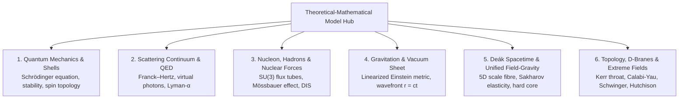

# Theoretical & Mathematical Model Hub

  <h4>⚠️ Important Scientific & Methodological Disclaimer</h4>
  

    This project is solely a <strong>thought-provoking, schematic visualization</strong> serving as the preliminary first step for preparing a more advanced project. 
    <strong>Neither the descriptions presented here nor the animation can be considered a correct, physically accepted model.</strong> 
    The visualizations and related theoretical descriptions are thought experiments and didactic tools; they do not represent an experimentally validated or canonical scientific theory.
  

This document provides a concise, structured overview of the theoretical framework behind the **Universal Quantum Visualisation System**. It bridges micro- and macro-physics across scales from the atomic level ($10^{-10}\,\mathrm{m}$) down to the Planck length ($\ell_P \sim 10^{-35}\,\mathrm{m}$).

---

## Epistemological Classification Taxonomy

To ensure scientific integrity, all statements within the model are categorized:
1. **[Standard Physics / Accepted Theory]**: Established, experimentally verified physics (Schrödinger equation, QED propagators, Franck–Hertz inelastic scattering, spontaneous Lyman-α emission, weak-field linearized Einstein equations, SU(3) color confinement, Mössbauer effect, Pound–Rebka gravitational redshift).
2. **[Model-specific Hypothesis]**: Theoretical synthesis developed in this project and the pedia repository (Deák 5D scale manifold $\rho = \ln(r/a_0)$, microscopic phase defect $\Delta\theta \sim \ell_P / \lambda_C$ inducing Newton's constant $G$, and the Heisenberg–Fermi quantum hard core repulsive barrier $+1/r^3$).
3. **[Illustrative Metaphor]**: 3D WebGL pedagogical visual representations (Kerr ring singularity throat as a zoom conduit, 3D projection of the 6D Calabi–Yau manifold, glowing virtual photon filaments, and the Janus antimatter $r < 0$ metric).

---

## Architecture of Theoretical Modules

---

## Detailed Thematic Sub-Pages (Hungarian Primary Reference)

- 📖 **[01. Quantum Mechanics, Orbitals and Atomic Stability](../hu/physics/01-kvantum-es-atom.md)**: Stationary states, analytical solutions of the Schrödinger equation, Heisenberg localization barrier as the true physical ground for stability, $SU(2)$ double-cover spin topology.
- 📖 **[02. Scattering Continuum, QED Vertex and Lyman-α Emission](../hu/physics/02-szoras-es-qed.md)**: Inelastic electron scattering, off-shell virtual photons ($Q^2 > 0$), electric dipole selection rules ($\Delta l = \pm 1$), spontaneous decay probability, on-shell vacuum UV photon ($\lambda = 121.57\,\mathrm{nm}$), and exact energy conservation ($15.0\,\mathrm{eV} = 4.8\,\mathrm{eV} + 10.2\,\mathrm{eV}$).
- 📖 **[03. Nucleon Interior, Nuclear Forces and Partons](../hu/physics/03-nukleon-es-parton.md)**: Collective nuclear shell and Yukawa pion exchange, proton/neutron valence quark structure ($uud$/$udd$), $SU(3)_C$ color confinement, Y-shaped flux tubes, Bjorken scaling in deep inelastic scattering, and Mössbauer recoilless resonance.
- 📖 **[04. Gravitation, Spacetime Curvature and Vacuum Dynamics](../hu/physics/04-gravitacio-es-vakuum.md)**: Linearized General Relativity, vacuum sheet sagging ($\delta g_{00} \approx +2GM/c^2r$), atomic dynamic mass increase ($\Delta M = 10.2\,\mathrm{eV}/c^2$), light-speed gravitational wavefront ($r = ct$), Pound–Rebka experiment, and critical analysis of gravity reversal.
- 📖 **[05. Deák Spacetime and Unified Field-Gravity Theory](../hu/physics/05-deak-ter-es-egyseges-elmelet.md)**: 5D Deák manifold ($d\hat{s}^2 = e^{2\sigma} g_{\mu\nu} dx^\mu dx^\nu + \lambda_C^2 d\rho^2$), Weyl gauge fixing via Dirac mass, absence of ether wind (Lorentz invariance and QRF scale-blindness), Sakharov induced gravity, microscopic derivation of $G$ from phase defect ($\Delta\theta \sim \ell_P / \lambda_C$), quantum hard core $+1/r^3$, and Greco (2026) informational geometry.
- 📖 **[06. Higher Dimensions, Topology and Extreme Phenomena](../hu/physics/06-topologia-es-kulonleges-jelensegek.md)**: D-branes and open/closed strings, Calabi–Yau compactification 3D projection, Kerr-Schild ring singularity ($x^2 + y^2 = a^2, z = 0$), Riemann zeta regularization ($\zeta(-1) = -1/12$), Schwinger critical field ($1.32 \times 10^{18}\,\mathrm{V/m}$), Janus mirror world ($r < 0$), and nonlinear electrodynamics of the Hutchison effect.

---

## Core Quantitative Constants

- **Bohr radius ($a_0$):** $0.529177 \times 10^{-10}\,\mathrm{m}$ (atomic scale reference, $\rho = 0$).
- **Rydberg ground energy:** $-13.6057\,\mathrm{eV}$.
- **Lyman-α transition energy:** $10.204\,\mathrm{eV}$ ($\lambda = 121.567\,\mathrm{nm}$).
- **Reduced Compton wavelength ($\lambda_C$):** $3.8616 \times 10^{-13}\,\mathrm{m}$ (conformal fibre quantum rigidity).
- **Planck length ($\ell_P$):** $1.616255 \times 10^{-35}\,\mathrm{m}$ (fundamental geometric resolution).
- **Microscopic phase error ($\Delta\theta$):** $\approx 4.18 \times 10^{-23}\,\mathrm{rad}$ ($\ell_P / \lambda_C$).
- **Excited mass increment ($\Delta M$):** $+1.818 \times 10^{-35}\,\mathrm{kg}$ ($10.2\,\mathrm{eV}/c^2$).
- **Proton recoil velocity ($v_{\text{recoil}}$):** $\approx 3.255\,\mathrm{m/s}$.

---

## Navigation & Related Docs

- 🚀 [Documentation Home](index.md)
- 📖 [User Guide](guide.md)
- ⚛️ [Unified Model](unified.md)
- 🛠️ [Installation Guide](installation.md)
