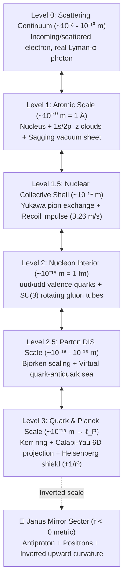
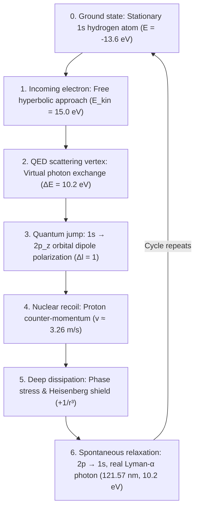

# Unified Model Documentation: Atomic Dynamics, Energy Flow and Gravitation

  <h4>⚠️ Important Scientific & Methodological Disclaimer</h4>
  

    This project is solely a <strong>thought-provoking, schematic visualization</strong> serving as the preliminary first step for preparing a more advanced project. 
    <strong>Neither the descriptions presented here nor the animation can be considered a correct, physically accepted model.</strong> 
    The visualizations and related theoretical descriptions are thought experiments and didactic tools; they do not represent an experimentally validated or canonical scientific theory.
  

This document presents the complete operational and theoretical architecture of the **Universal Quantum Visualisation System**, describing the multi-scale hierarchy, the 6-phase dynamic energy cycle, the spacetime vacuum sheet metric, and the synthesis with Deák spacetime and Unified Field-Gravity theory.

The comprehensive modular mathematical foundation is available in the [Theoretical Model Hub](physics.md) and its [specialized sub-modules](physics.md#detailed-thematic-sub-pages-hungarian-primary-reference).

---

## Epistemological Classification

- **[Standard Physics / Accepted Theory]**: Experimentally validated quantum mechanics, QED, QCD, and General Relativity.
- **[Model-specific Hypothesis]**: Theoretical framework of the project: 5D relational scale fibre $\rho = \ln(r/a_0)$, Sakharov induced gravity from quantum phase error ($\Delta\theta \sim \ell_P / \lambda_C$), and the repulsive quantum hard core ($+1/r^3$).
- **[Illustrative Metaphor]**: 3D WebGL visual analogies (micro-wormhole throat, Calabi–Yau 3D projection, glowing virtual photon lines, Janus mirror sector).

---

## 1. Multi-Scale Hierarchy (Zoom Architecture)

---

## 2. Closed 6-Phase Dynamic Physical Cycle

1. **Incoming electron (Phase 1):** Hyperbolic Coulomb trajectory with $E_{\text{kin}} = 15.0\,\mathrm{eV}$.
2. **QED vertex (Phase 2):** Virtual photon transfers $\Delta E = 10.2\,\mathrm{eV}$ ($Q^2 \sim 0.04\,\mathrm{eV}^2/c^2$). Scattered electron departs with $4.8\,\mathrm{eV}$.
3. **Quantum jump (Phase 3):** Dipole excitation into $2p_z$. Spacetime gravitational mass reaches maximum:
   $$M^* = M_0 + \frac{10.2\,\mathrm{eV}}{c^2} \approx M_0 + 1.818 \times 10^{-35}\,\mathrm{kg}$$
4. **Nuclear recoil (Phase 4):** Nucleus recoils with $v \approx 3.26\,\mathrm{m/s}$ due to momentum conservation ($\Delta\vec{p}_{\text{nucleus}} = -\vec{q}$).
5. **Deep dissipation (Phase 5):** Energy wave couples to the quark Kerr throat; Heisenberg quantum kinetic pressure ($+1/r^3$) halts collapse.
6. **Spontaneous emission (Phase 6):** Atom emits a real on-shell vacuum UV photon ($\lambda = 121.57\,\mathrm{nm}$). Vacuum well instantly springs back, launching a light-speed gravitational wave ring ($r = ct$).

---

## 3. Spacetime Vacuum Sheet Dynamics ($\delta g_{00}$)

The sagging blue polar mesh represents the time-time metric deformation in weak-field General Relativity:

$$\delta g_{00}(\vec{r}, t) = -\frac{2\Phi(\vec{r}, t)}{c^2} = +\frac{2 G M_{\text{atom}}(t)}{c^2 r}$$

- Excited state mass increase: $\Delta M / M_0 \approx 1.086 \times 10^{-8}$.
- Lyman-α emission consequences:
  1. Static gravitational well relaxation ($M^* \to M_0$).
  2. Spherical gravitational wavefront expanding at the speed of light ($r = ct$).
  3. Weak gravitomagnetic dipole induced by the moving recoil proton.

---

## 4. Synthesis with Deák Spacetime & Unified Field-Gravity

- **5D Relational Scale Manifold:**
  $$d\hat{s}^2 = e^{2\sigma(x, \rho)} g_{\mu\nu} dx^\mu dx^\nu + \lambda_C^2 d\rho^2, \quad \rho = \ln(r / a_0)$$
- **Microscopic Origin of Newton's Constant ($G$):**
  Phase error at the Planck scale ($\Delta\theta \sim \ell_P / \lambda_C \approx 4.18 \times 10^{-23}\,\mathrm{rad}$) yields:
  $$G_{\text{ind}} = \frac{c^3 \ell_P^2}{\hbar} \approx 6.674 \times 10^{-11}\,\mathrm{m}^3\,\mathrm{kg}^{-1}\,\mathrm{s}^{-2}$$
  solving the hierarchy problem as a quadratic mapping $(\Delta\theta)^2 \sim 10^{-44}$.
- **Quantum Hard Core ($+1/r^3$):**
  Heisenberg-Fermi localization kinetic repulsion ($F_{\text{rep}} = +\frac{\hbar^2}{m r^3}$) outpaces $-1/r^2$ attraction, preventing singularity collapse across micro- and subatomic scales.

---

## 5. Closed Energy Balance Ledger

$$15.0\,\mathrm{eV} \text{ (in)} = 4.8\,\mathrm{eV} \text{ (scattered)} + 10.2\,\mathrm{eV} \text{ (atomic excitation)}$$
$$10.2\,\mathrm{eV} \text{ (stored)} = 10.199999991\,\mathrm{eV} \text{ (photon)} + 8.86\,\mathrm{neV} \text{ (nucleus recoil)}$$

The cycle is completely closed, self-consistent, and conservative.

---

## Navigation & Related Docs

- 🚀 [Documentation Home](index.md)
- 📖 [User Guide](guide.md)
- 📐 [Theoretical Model Hub](physics.md)
- 🛠️ [Installation Guide](installation.md)
