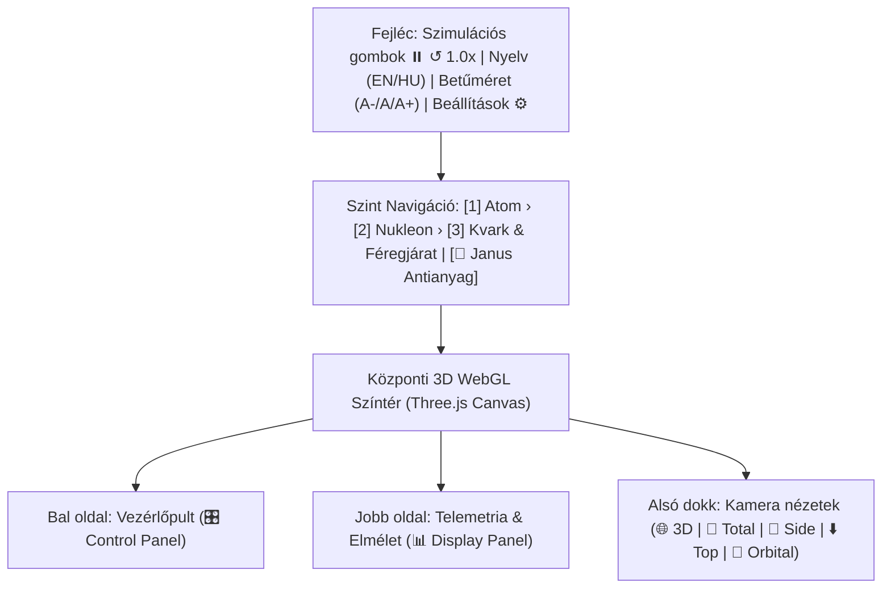
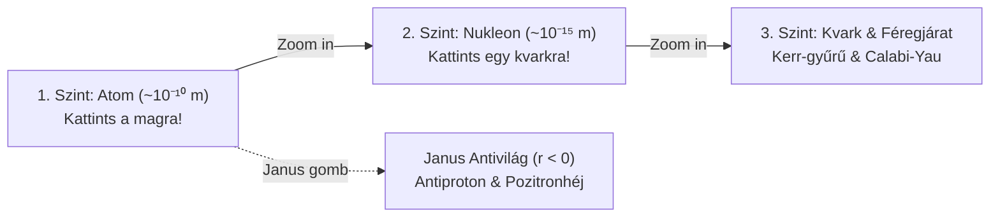
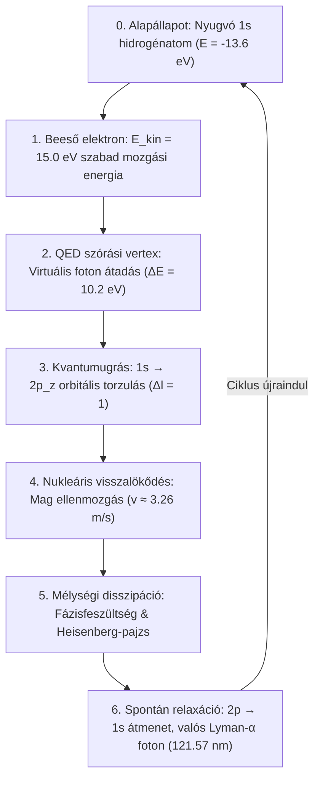

# Használati Útmutató (User Guide)

  <h4>⚠️ Figyelem / Tudományos Nyilatkozat</h4>
  

    Ez a projekt egy <strong>gondolatindító, vázlatos vizualizáció</strong>, amely egy fejlettebb projekt előkészítésének első lépése. 
    <strong>Sem az itt leírtakat, sem pedig az animációt nem lehet helyes, fizikailag elfogadott modellként kezelni.</strong> 
    A vizualizáció és a kapcsolódó leírások hipotetikus és didaktikai jellegűek, pedagógiai képi eszközöket alkalmaznak, és nem minősülnek kísérletileg igazolt tankönyvi fizikának.
  

Ez a kézikönyv lépésről lépésre bemutatja az **Univerzális Kvantum- és Atomvizualizációs Rendszer** interaktív kezelőfelületét, a 3D navigációt, a 3 szintű beágyazott struktúra és a Janus antianyag szektor bejárását, valamint a 6 fázisú dinamikus folyamatszimulátor működését.

---

## 1. A kezelőfelület elrendezése

A képernyő ergonomikus, sötét tónusú üvegmorfológiai (glassmorphism) elrendezést követ:

### Főbb felületi elemek:
1. **Felső fejléc és állapotsor:**
   - **Szimuláció vezérlők:** Szünet/Folytatás (`⏸️ / ▶️`), Idő visszaállítása (`↺`), Időlépték csúszka (`0.0x – 3.0x`).
   - **Nyelvválasztó:** Azonnali dinamikus váltás angol (`EN`) és magyar (`HU`) között az összes panelen és 3D feliraton.
   - **Betűméret skálázó:** Három fokozat (`A-`, `A`, `A+`) a tökéletes olvashatóságért minden képernyőméreten.
   - **Beállítások modál (`⚙️`):** Háttér stílus, fényerő, utómunka effektusok és helyi perzisztencia (LocalStorage).
2. **Szintnavigációs sáv (Breadcrumbs):**
   - Visszalépés gomb (`← Back`) mélyebb szintekről.
   - 1. Atom $\to$ 2. Nukleon $\to$ 3. Kvark & Féregjárat közvetlen szintválasztó gombok.
   - **Janus Antianyag váltógomb (`🌌`):** Átkapcsolás az $r < 0$ inverz tükörvilágba.
3. **Bal oldali Vezérlőpult (Control Panel):**
   - Rétegkapcsolók, kvantumszámok ($n, l, m$), periódusos rendszer választó, többatomos elrendezések.
4. **Jobb oldali Telemetriai Panel (Display Panel):**
   - Élő kvantumfizikai adatok, energiamérleg, gravitációs kútmélység ($\delta g_{00}$), fázis-információk.
5. **Alsó lebegő kamera dokk:**
   - Gyors kameranézetek egyetlen kattintással.

---

## 2. Kamera és térbeli navigáció

A 3D színtér a Three.js `OrbitControls` motorjával szabadon bejárható:

| Művelet | Egér | Érintőképernyő / Touch | Funkció |
| :--- | :--- | :--- | :--- |
| **Forgatás (Orbit)** | Bal egérgomb nyomva tartva + mozgatás | 1 ujjas húzás | Körbeforgás a fókuszpont körül |
| **Pásztázás (Pan)** | Jobb egérgomb nyomva tartva + mozgatás | 2 ujjas párhuzamos húzás | A kamera oldalirányú és függőleges eltolása |
| **Közelítés / Távolítás (Zoom)** | Egérgörgő fel / le | 2 ujjas csiptetés (pinch) | Folytonos ráközelítés vagy távolítás |

### Dedikált kameranézetek (Alsó dokk):
- **🌐 3D (Perspektivikus alapértelmezett):** Átfogó térbeli rálátás az atomra és a görbült vákuumszőnyegre.
- **🔭 Total (Teljes vertikális rendszer):** Rálátás a teljes multiverzális tengelyre az atommagtól és elektronoktól a megereszkedő vákuumon és az Einstein–Rosen hídon át a lenti Janus tükörvilágig és antiproton magig.
- **🔬 Side (Oldalnézet):** Ideális a $2p_z$ és $3d$ orbitális lebenyek és az elektronok lebegési síkjának vizsgálatára.
- **⬇️ Top (Felülnézet):** Tiszta rálátás az azimutális szimmetriára és a többatomos kristályrácsokra.
- **📐 Orbital (Pályasík):** A szórási és visszalökődési impulzusvektor tengelyébe forgatott kameraállás.

---

## 3. A három beágyazott szint és a Janus-szektor

A rendszer legfontosabb sajátossága a **többszintű mikroszkopikus hierarchia**, amely valósághűen hidalja át a $10^{-10}\,\mathrm{m}$-es atomi mérettől a $10^{-19}\,\mathrm{m} \to \ell_P$ Planck-skáláig terjedő mérettartományt.

### 1. Szint: Atomi méret ($\sim 10^{-10}\,\mathrm{m} = 1\,\mathrm{Å}$)
- **Mit látunk?** A centrális atommag, körülötte a kvantummechanikai elektronsűrűség-felhők ($1s, 2p, 3d$), az energiaáramlást jelképező virtuális fotonáramok, és alattuk a téridő görbületét modellező **megereszkedő vákuumszőnyeg**.
- **Hogyan lépjünk tovább?** Kattintsunk a bal egérgombbal a villódzó **atommagra**, vagy a felső sávban a **[2] Nucleon** gombra!

### 2. Szint: Nukleon belső folyamatok ($\sim 10^{-15}\,\mathrm{m} = 1\,\mathrm{fm}$)
- **Mit látunk?** A proton vagy neutron belső hadronikus szerkezete:
  - 3 valenciakvark ($uud$ proton esetén, $udd$ neutron esetén) forgó SU(3) szín-töltésekkel (piros, zöld, kék).
  - Y-alakú, pulzáló gluon-fluxustubusok, amelyek a szín-bezárást (color confinement) biztosítják.
  - Fluktuáló virtuális kvark-tenger és az atommagot összetartó Yukawa-pioncsere filamensek.
- **Interakció:** A bal oldali vezérlőpulton átkapcsolhatunk **p⁺ Proton** és **n⁰ Neutron** mód között, illetve ki-be kapcsolhatjuk a virtuális kvarktengert és a MIT Bag határfelületet.
- **Hogyan lépjünk tovább?** Kattintsunk közvetlenül az egyik keringő **kvarkra**, vagy a felső sávban a **[3] Quark & Wormhole** gombra!

### 3. Szint: Kvark belseje és mikro-féregjárat ($\sim 10^{-19}\,\mathrm{m} \to \ell_P$)
- **Mit látunk?** A részecske legmélyebb mikroszkopikus geometriája:
  - Forgó Kerr-gyűrű mikro-szingularitás fénysebességű ergociklussal.
  - A 6D Calabi–Yau sokaság 3D vetülete, ahol az extra dimenziók rezgése zajlik.
  - A **Heisenberg-visszapattanás taszító pajzsa** ($+1/r^3$), amely meggátolja a geometriai összeomlást.
  - Mikro-fekete lyuk eseményhorizont és virtuális párok elszakadása (Hawking-párolgás és gravitációs visszhangok).

### 🌌 Janus Antianyag Tükörszektor ($r < 0$ tartomány)
- A jobb felső **"🌌 Janus Antimatter"** gombra kattintva a téridő koordinátatengelye invertálódik:
- Megjelenik a negatív energiasűrűségű tükörállapot: rubin-vörös antiproton mag, ellenirányban keringő pozitronhéjak és felfelé domborodó gravitációs szövet.

---

## 4. A 6 fázisú dinamikus folyamatszimulátor

A szimulátor egy teljes, zárt fizikai ciklust játszik le a külső elektron becsapódásától a Lyman-α foton kisugárzásáig:

### Kezelése a jobb oldali panelen:
- **▶️ Folyamat Indítása / Szüneteltetése:** Elindítja a folyamatos automatikus fázisátmenetet.
- **Fázisválasztó gombok (0-tól 6-ig):** Bármelyik fázisra azonnal ráugorhatunk közvetlen tanulmányozásra.
- **Élő telemetria kijelzők:**
  - **Energiamérleg:** $E_{\text{in}} = 15{,}0\,\mathrm{eV} \to E_{\text{out}} = 4{,}8\,\mathrm{eV} + \Delta E = 10{,}2\,\mathrm{eV}$.
  - **Négyesimpulzus-átadás ($Q^2$):** A virtuális foton téreszerű csatolása.
  - **Gravitációs tömeg:** $M^* = M_0 + 10{,}2\,\mathrm{eV}/c^2$ a 3. fázisban, majd visszaugrás $M_0$-ra a fotonkibocsátáskor.
  - **Vákuumszőnyeg megereszkedés:** Grafikus és számszerű mélységérték ($\delta g_{00}$).

---

## 5. Rétegek és vizualizációs komponensek testreszabása

A bal oldali vezérlőpulton minden komponens egymástól függetlenül ki- és bekapcsolható:

| Réteg neve | Mit jelenít meg? | Mikor érdemes használni? |
| :--- | :--- | :--- |
| **Atommag (Nucleus)** | Protonok (piros) és neutronok (kék) szférái | A nukleáris méret és a héjak távolságarányának vizsgálatakor. |
| **3D Elektronfelhő (Cloud)** | Pontfelhős valószínűségi $|\psi|^2$ sűrűségeloszlás | A Schrödinger-hullámfüggvény térbeli kiterjedésének megértéséhez. |
| **Sűrűségszelet (Density Slice)** | 2D síkmetszeti hőtérkép a valószínűségi sűrűségről | Orbitális csomóvonalak és valószínűségi maximumok kimérésére. |
| **Valós Orbitál Alakzatok (Real Shapes)** | 3D izofelületek (gömbök, lebenyek, tóruszok) | Kémiai kötések és hibridizációk szemléltetésére. |
| **Csomófelületek (Nodal Surfaces)** | Radiális és szögfüggő zérus-valószínűségű héjak | A kvantumszámok ($n-l-1$) geometriai értelmezéséhez. |
| **Vákuumszőnyeg (Vacuum Sheet)** | A téridő görbülete (kék hiperbolikus rácsháló) | A tömeg-energia ekvivalencia és gravitációs kút dinamikájának követésére. |
| **Energiaáramlás (Energy Flow)** | Aranyszínű pulzáló fotoncsatornák és virtuális párok | A héjak és az extra dimenziók közötti energiacsere megjelenítésére. |
| **Külső elektronnyaláb (External Beam)** | Szabad elektron hiperbolikus szórási pályája | A szórási folyamat és az ütközési paraméter tanulmányozására. |

---

## 6. Kvantumállapotok és a Periódusos Rendszer

A vezérlőpulton a kvantummechanikai állapotok és a valós kémiai elemek **kétirányúan szinkronizálva vannak**:
1. **Főkvantumszám ($n = 1..4$):** Az elektron fő héjának távolságát határozza meg.
2. **Mellékkvantumszám ($l = 0..3$):** Az alhéj alakját szabályozza ($s$: gömb, $p$: dipól-lebeny, $d$: négyes lebeny, $f$: komplex oktupól).
3. **Mágneses kvantumszám ($m = -l..+l$):** Az orbitál térbeli orientációját forgatja el.
4. **Periódusos rendszer modál (`📋 Periódusos Rendszer`):**
   - Kattintásra megnyílik a teljes Mengyelejev-táblázat ($Z = 1$-től $Z = 36$-ig).
   - Bármely elemre (pl. C, Fe, Cu) kattintva a szimulátor automatikusan beállítja az atom rendszámát, a mag proton/neutron arányát és a vegyértékelektron legjellemzőbb orbitálját!

---

## 7. Beállítások és Billentyűkombinációk

- **Szóköz (Space):** A szimuláció azonnali megállítása vagy elindítása (Pause/Play).
- **R gomb:** Idő és kamera pozíció visszaállítása alaphelyzetbe.
- **Escape (Esc):** Nyitott modál ablakok (Beállítások, Periódusos tábla) azonnali bezárása.
- **LocalStorage mentés:** A rendszer minden beállítást (kiválasztott elem, aktív rétegek, hangerő, időlépték, nyelv, betűméret) automatikusan elment a böngésző helyi tárhelyére, így az oldal újratöltésekor pontosan a korábbi állapot fogadja a felhasználót.

---

## Navigáció és Részletes Anyagok

- 🚀 [Központi Kezdőlap](index.md)
- 📐 [Fizikai-Matematikai Modell Összegző Központ](physics.md)
- ⚛️ [Egységes Modell](unified.md)
- 🛠️ [Telepítési Útmutató](installation.md)
