# Fizikai és Matematikai Modell: Elméleti Összegző Központ

  <h4>⚠️ Figyelem / Tudományos Nyilatkozat</h4>
  

    Ez a projekt egy <strong>gondolatindító, vázlatos vizualizáció</strong>, amely egy fejlettebb projekt előkészítésének első lépése. 
    <strong>Sem az itt leírtakat, sem pedig az animációt nem lehet helyes, fizikailag elfogadott modellként kezelni.</strong> 
    A vizualizáció és a kapcsolódó elméleti leírások gondolatkísérletek és pedagógiai reprezentációs eszközök; nem minősülnek kísérletileg igazolt tankönyvi fizikának vagy konszenzusos tudományos modellnek.
  

Ez a dokumentum a **Quantum Visualisation** 3D WebGL szimulációs rendszer fizikai, matematikai és térelméleti hátterének koherens, rendszerezett összegzője. Célja, hogy áttekinthető szerkezetben, logikus sorrendben és egzakt matematikai egyenletekkel mutassa be a mikro- és makroskála közötti kapcsolatot a $10^{-10}\,\mathrm{m}$-es atomi mérettől a Planck-skáláig ($\ell_P \sim 10^{-35}\,\mathrm{m}$), közvetlen moduláris linkeket adva a részletes kifejtő lapokhoz.

---

## Elméleti Besorolási Rendszer (Episztemológiai Taxonómia)

A szakmai hitelesség és az átláthatóság érdekében a rendszer minden állítása és tétele az alábbi három kategória egyikébe tartozik:

1. [Standard Fizika / Elfogadott Elmélet]: Kísérletileg igazolt és a tudományos konszenzus által elfogadott tankönyvi elméletek (Schrödinger-egyenlet, QED propagátorok, Franck–Hertz szórás, spontán Lyman-α emisszió, linearizált Einstein-egyenletek, SU(3) szín-bezárás, Mössbauer-effektus, Pound–Rebka vöröseltolódás).
2. [Modell-specifikus Hipotézis]: A projekt és a pedia repo saját térelméleti szintézise (a Deák-sokaság 5D relációs skálaszálja $\rho = \ln(r/a_0)$, a Newton-állandó $G$ származtatása a Dirac–Maxwell fázishibából $\Delta\theta \sim \ell_P / \lambda_C$, és a Heisenberg–Fermi kvantum kemény mag $+1/r^3$).
3. [Szemléltető Metafora]: A 3D WebGL környezetben alkalmazott pedagógiai képi eszközök (a kvark belső Kerr-gyűrűje és torkolata mint mélységi zoom-kapu, a 6D Calabi–Yau sokaság 3D vetülete, a pulzáló arany fotonszálak és a Janus tükörvilág $r < 0$ metrikája).

---

## A Rendszer Elméleti Architektúrája

A modell felépítése szigorú hierarchikus láncolatot követ, amelyben az egyes fizikai szintek zökkenőmentesen kapcsolódnak egymáshoz:

```mermaid
flowchart TD
  Hub["Fizikai-Matematikai Modell (Összegző Központ)"]

  subgraph Pillar1 [I. Atomi & Kvantum Alapok]
    Mod1["1. Kvantummechanika & Elektronhéjak<br/>Schrödinger-egyenlet, stabilitás, spin-topológia"]
    Link1["👉 docs/hu/physics/01-kvantum-es-atom.md"]
    Mod1 --- Link1
  end

  subgraph Pillar2 [II. Szórás & Elektrodinamika]
    Mod2["2. Szórási Kontínuum & QED<br/>Franck–Hertz, virtuális fotonok, Lyman-α"]
    Link2["👉 docs/hu/physics/02-szoras-es-qed.md"]
    Mod2 --- Link2
  end

  subgraph Pillar3 [III. Nukleáris & Szubatomos Világ]
    Mod3["3. Nukleon, Hadronok & Magerők<br/>SU(3) gluon-tubusok, Mössbauer-effektus, DIS"]
    Link3["👉 docs/hu/physics/03-nukleon-es-parton.md"]
    Mod3 --- Link3
  end

  subgraph Pillar4 [IV. Téridő & Gravitáció]
    Mod4["4. Gravitáció & Vákuumszőnyeg<br/>Linearizált Einstein-metrika, hullámfront r = ct"]
    Link4["👉 docs/hu/physics/04-gravitacio-es-vakuum.md"]
    Mod4 --- Link4
  end

  subgraph Pillar5 [V. Egységes Szintézis]
    Mod5["5. Deák-tér & Egységes Tér-Gravitáció<br/>5D skálaszál, Szaharov-rugalmasság, kemény mag"]
    Link5["👉 docs/hu/physics/05-deak-ter-es-egyseges-elmelet.md"]
    Mod5 --- Link5
  end

  subgraph Pillar6 [VI. Magasabb Dimenziók & Extrém Terek]
    Mod6["6. Topológia, D-bránok & Extrém Terek<br/>Kerr-gyűrű, Calabi-Yau, Schwinger, Hutchison"]
    Link6["👉 docs/hu/physics/06-topologia-es-kulonleges-jelensegek.md"]
    Mod6 --- Link6
  end

  Hub --> Pillar1
  Hub --> Pillar2
  Hub --> Pillar3
  Hub --> Pillar4
  Hub --> Pillar5
  Hub --> Pillar6
```

---

## Rendszerezett Elméleti Fejezetek és Csomópontok

### 1. Kvantummechanika, Elektronhéjak és Atomi Stabilitás
- **Miről szól?** Az atom stacionárius elektronállapotai, a Schrödinger-egyenlet analitikus megoldásai, a klasszikus sugárzási összeomlás kudarca, a Heisenberg-féle kinetikus lokalizációs gát mint az atom valódi stabilitási alapja, valamint az elektronspin mint az $SU(2)$ kétszeres fedőcsoport Möbius-topológiája.
- **Kulcskifejezések:** $R_{nl}(r)$, $Y_{lm}(\theta,\phi)$, Bohr-sugár ($a_0 \approx 0{,}529\,\mathrm{Å}$), Dirac-öv $4\pi$ szimmetria, topológiai kvantumszámok.
- **Részletes dokumentáció:** 📖 **[01. Kvantummechanika, Elektronhéjak és Atomi Stabilitás](physics/01-kvantum-es-atom.md)**

---

### 2. Szórási Kontínuum, QED Vertex és Lyman-α Emisszió
- **Miről szól?** A szabad elektron szóródása az atomon (Franck–Hertz mechanizmus), a QED szórási vertex, a virtuális foton téreszerű impulzusátadása ($Q^2 > 0$), az elektromos dipól kiválasztási szabályok ($\Delta l = \pm 1$, miért tiltott az $1s \to 2s$), a spontán emisszió átmeneti valószínűsége ($A_{21}$), a valós vákuum-ultraibolya Lyman-α foton ($\lambda = 121{,}57\,\mathrm{nm}$), és a zárt energiamérleg ($15{,}0\,\mathrm{eV} = 4{,}8\,\mathrm{eV} + 10{,}2\,\mathrm{eV}$).
- **Kulcskifejezések:** $Q^2 \equiv -q^2$, Feynman-propagátor $D_F(x-y)$, $1s \to 2p_z$ dipól-polarizáció, zérusponti fluktuációk.
- **Részletes dokumentáció:** 📖 **[02. Szórási Kontínuum, QED Vertex és Lyman-α Emisszió](physics/02-szoras-es-qed.md)**

---

### 3. Nukleon Belső, Magerők és Részecskestruktúra
- **Miről szól?** Az atommag kollektív héjszerkezete és a virtuális pioncsere Yukawa-potenciálja ($V_{\text{Yukawa}}$), a proton és neutron belső szerkezete ($uud$ és $udd$), az $SU(3)_C$ szín-szimmetria és szín-bezárás, az Y-alakú gluon fluxustubusok, a mélyen rugalmatlan szórás (DIS) Bjorken-skálázása és aszimptotikus szabadsága, valamint a nukleáris rezonancia fluoreszcencia (NRF) és a Mössbauer-effektus visszalökődésmentes Debye–Waller elmélete.
- **Kulcskifejezések:** Confinement, MIT Bag modell, $\kappa \approx 1\,\mathrm{GeV/fm}$, $x_{\text{Bj}}$, Fe-57 Mössbauer nívó ($14{,}41\,\mathrm{keV}$), Debye–Waller faktor ($f$).
- **Részletes dokumentáció:** 📖 **[03. Nukleon Belső, Magerők és Részecskestruktúra](physics/03-nukleon-es-parton.md)**

---

### 4. Gravitáció, Téridő-görbület és a Vákuumszőnyeg Dinamikája
- **Miről szól?** Az Einstein-féle Általános Relativitáselmélet gyenge terű linearizált alakja, a vákuumszőnyeg megereszkedése ($\delta g_{00} \approx -2\Phi/c^2 = +2GM/c^2r$), az atom dinamikus tömegváltozása a gerjesztés során ($\Delta M = 10{,}2\,\mathrm{eV}/c^2$), a vákuumszőnyeg fázisonkénti mélységprofilja, a spontán fotonkibocsátás után fénysebességgel táguló gravitációs hullámfront ($r = ct$), a Pound–Rebka gravitációs vöröseltolódási kísérlet, és a gravitációs hatásirány megváltoztathatóságának kritikai vizsgálata.
- **Kulcskifejezések:** $g_{00}$ időszerű metrika-komponens, retardált gravitációs hullámfront, Eddington-lebegtetés sugárnyomással, gravitomágneses dipól.
- **Részletes dokumentáció:** 📖 **[04. Gravitáció, Téridő-görbület és a Vákuumszőnyeg Dinamikája](physics/04-gravitacio-es-vakuum.md)**

---

### 5. A Deák-tér és az Egységes Tér-Gravitáció Elmélet
- **Miről szól?** A pedia repóból átemelt egységes elméleti szintézis: a Deák-sokaság 5D vonaleleme ($d\hat{s}^2 = e^{2\sigma} g_{\mu\nu} dx^\mu dx^\nu + \lambda_C^2 d\rho^2$), a Weyl-féle mértéktér rögzítése az elektron Dirac-tömegével, miért nincs klasszikus éterszél (Lorentz-invariáns vákuum és QRF skála-vakság), Andrej Szaharov indukált gravitációja, a Newton-állandó ($G$) mikrofizikai levezetése a zárt fermionpályák fázishibájából ($\Delta\theta \sim \ell_P / \lambda_C$), a gravitációs szingularitásokat megsemmisítő Heisenberg–Fermi kvantum kemény mag ($+1/r^3$), valamint Giuseppe Greco információs geometriája (torzió és dekompresszió).
- **Kulcskifejezések:** Relációs skálaszál $\rho = \ln(r/a_0)$, hierarchia-probléma kvadratikus feloldása, $r_{\text{bounce}}$, információs torzió $\rho_I > \rho_c$.
- **Részletes dokumentáció:** 📖 **[05. A Deák-tér és az Egységes Tér-Gravitáció Elmélet](physics/05-deak-ter-es-egyseges-elmelet.md)**

---

### 6. Magasabb Dimenziók, Topológia és Különleges Jelenségek
- **Miről szól?** Húrelméleti D-bránok (a 3-bránhoz kötött nyitott húrok vs. a magasabb dimenziós bulkban szabadon mozgó zárt gravitonhurkok), a 6D kompakt Calabi–Yau sokaság 3D vetülete, a kvark magjának Kerr-Schild gyűrűszingularitása ($x^2 + y^2 = a^2, z = 0$), a Riemann-zéta regularizáció szerepe a kritikus dimenziókban és a kvantumkaosz szintstatisztikájában, a Schwinger-féle vákuum-párkeltés extrém elektromos térben ($E_{\text{cr}} \approx 1{,}32 \times 10^{18}\,\mathrm{V/m}$), a Janus-antivilág ($r < 0$ inverz metrika), és a Hutchison-effektus nemlineáris elektrodinamikai elemzése (két Tesla-tekercs lebegése, Debye–Waller összeomlás és ponderomotoros levitáció).
- **Kulcskifejezések:** Calabi–Yau vetület, Kerr-torkolat, $\zeta(-1) = -1/12$, Schwinger-limit, Lindemann-olvadás, $\vec{F}_{\text{lev}} = \frac{1}{2}\alpha \nabla \langle |E|^2 \rangle$.
- **Részletes dokumentáció:** 📖 **[06. Magasabb Dimenziók, Topológia és Különleges Jelenségek](physics/06-topologia-es-kulonleges-jelensegek.md)**

---

## Összegző Kvantitatív Referenciatáblázat

| Fizikai Állandó / Paraméter | Érték | Szerepe a Modellben |
| :--- | :--- | :--- |
| **Bohr-sugár ($a_0$)** | $0{,}529177 \times 10^{-10}\,\mathrm{m}$ | Az atomi skála természetes etalonja; $\rho = 0$ referencia-pont. |
| **Rydberg-energia ($R_\infty hc$)** | $13{,}6057\,\mathrm{eV}$ | A hidrogénatom alapállapoti kötési energiája ($E_{1s}$). |
| **Lyman-α átmeneti energia ($\Delta E$)** | $10{,}204\,\mathrm{eV}$ | Az $1s \to 2p_z$ gerjesztés és a relaxációs foton energiája. |
| **Lyman-α hullámhossz ($\lambda$)** | $121{,}567\,\mathrm{nm}$ | Vákuum-ultraibolya hullámcsomag az 6. fázisban. |
| **Redukált Compton-hossz ($\lambda_C$)** | $3{,}8616 \times 10^{-13}\,\mathrm{m}$ | Az 5. relációs skálaszál kvantumos merevségi modulusa. |
| **Planck-hossz ($\ell_P$)** | $1{,}616255 \times 10^{-35}\,\mathrm{m}$ | A téridő fundamentális geometriai felbontási határa. |
| **Mikrofizikai fázishiba ($\Delta\theta$)** | $\approx 4{,}18 \times 10^{-23}\,\mathrm{rad}$ | Az atomi pálya Planck-késése; a gravitáció eredő forrása. |
| **Atomi tömegnövekedés ($\Delta M$)** | $+1{,}818 \times 10^{-35}\,\mathrm{kg}$ | A $2p_z$ gerjesztett állapot gravitáló többlettömege. |
| **Mag visszalökődési sebesség ($v_{\text{recoil}}$)** | $\approx 3{,}255\,\mathrm{m/s}$ | A fotonimpulzus megmaradásából fakadó protonmozgás. |
| **Schwinger-féle kritikus térerő ($E_{\text{cr}}$)** | $1{,}32 \times 10^{18}\,\mathrm{V/m}$ | A vákuum spontán elektron-pozitron párkeltési küszöbe. |

---

## Navigáció és További Kapcsolódó Útmutatók

- 🚀 [Központi Kezdőlap](index.md)
- 📖 [Használati Útmutató](guide.md)
- ⚛️ [Egységes Modell Dokumentáció](unified.md)
- 🛠️ [Telepítési Útmutató](installation.md)
