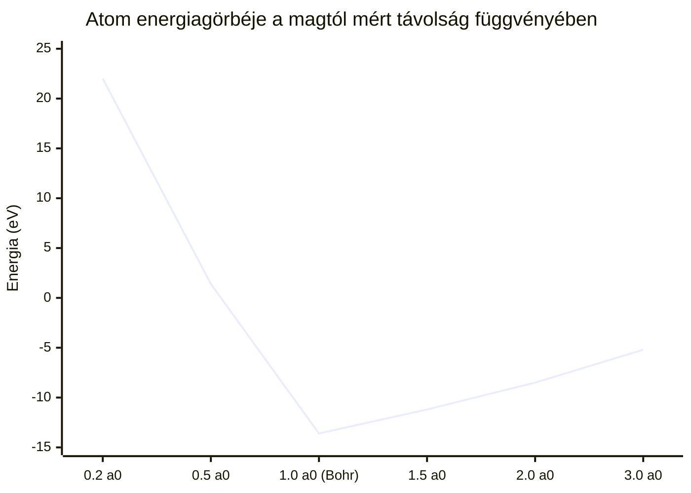

# 1. Kvantummechanika, Elektronhéjak és Atomi Stabilitás

Ez a dokumentum a vizualizációs rendszer 1. szintjét (Atomi méretskála: $\sim 10^{-10}\,\mathrm{m} = 1\,\mathrm{Å}$) leíró fizikai és matematikai alapokat tárgyalja.

---

## Elméleti Besorolás és Módszertan

A dokumentációban szereplő állítások besorolása a rendszer egységes taxonómiája szerint:
- [Standard Fizika / Elfogadott Elmélet] — Kísérletileg és elméletileg igazolt tankönyvi kvantummechanika és elektrodinamika.
- [Modell-specifikus Hipotézis] — A projekt saját térelméleti modellje (fázisfordulatok, skálatengely menti keringés).
- [Szemléltető Metafora] — 3D WebGL képi reprezentációs kód a szemléletesség segítésére.

---

## 1. Elektron Állapotok és a Schrödinger-egyenlet

[Standard Fizika / Elfogadott Elmélet]

A hidrogénszerű atomok stacionárius elektronállapotait az időfüggetlen Schrödinger-egyenlet írja le centrális Coulomb-potenciálban ($V(r) = - \frac{Z e^2}{4\pi\varepsilon_0 r}$):

$$\hat{H}\psi(\vec{r}) = E\psi(\vec{r}) \implies \left[ -\frac{\hbar^2}{2 m_e}\nabla^2 - \frac{Z e^2}{4\pi\varepsilon_0 r} \right] \psi(\vec{r}) = E\psi(\vec{r})$$

A hullámfüggvény gömbi koordinátarendszerben szétválasztható radiális és anguláris komponensekre:

$$\psi_{nlm}(r, \theta, \phi) = R_{nl}(r) Y_{lm}(\theta, \phi)$$

### A) Radiális megoldás:
$$R_{nl}(r) = \sqrt{\left(\frac{2Z}{n a_0}\right)^3 \frac{(n - l - 1)!}{2n [(n + l)!]}} \cdot e^{-\rho/2} \cdot \rho^l \cdot L_{n-l-1}^{2l+1}(\rho)$$

ahol $\rho = \frac{2 Z r}{n a_0}$, $a_0 = \frac{4\pi\varepsilon_0 \hbar^2}{m_e e^2} \approx 0{,}529177\,\mathrm{Å}$ a Bohr-sugár, $L_{n-l-1}^{2l+1}(\rho)$ pedig a társult Laguerre-polinom.

### B) Szögfüggő komponens (Gömbi harmonikusok):
$$Y_{lm}(\theta, \phi) = (-1)^m \sqrt{\frac{2l + 1}{4\pi}\frac{(l - m)!}{(l + m)!}} P_l^m(\cos\theta) e^{i m \phi}$$

ahol $P_l^m(\cos\theta)$ a társult Legendre-polinom.

A 3D vizualizációban ([`src/core/QuantumPhysics.js`](https://github.com/LowCoders/atom-visualisation/blob/main/src/core/QuantumPhysics.js)) a valós (nem komplex) gömbfüggvényeket alkalmazzuk a kémiában megszokott valós orbitális lebenyek ($p_x, p_y, p_z, d_{z^2}, d_{x^2-y^2}$ stb.) közvetlen renderelésére.

---

## 2. Kvantumstabilitás: Miért nem zuhan az elektron a magba?

### A klasszikus elektrodinamika kudarca
[Standard Fizika / Elfogadott Elmélet]

A klasszikus Larmor-formula szerint egy $a$ gyorsulással keringő elektron másodpercenként kisugározza az alábbi energiát:

$$P = \frac{e^2 a^2}{6\pi\varepsilon_0 c^3} = \frac{e^2}{6\pi\varepsilon_0 c^3} \left(\frac{e^2}{4\pi\varepsilon_0 m_e r^2}\right)^2$$

A kisugárzott energia miatt az elektron pályasugara folytonosan csökkenne, és a magba spirálozna mindössze:

$$\tau_{\text{collapse}} \approx \frac{4\pi\varepsilon_0 m_e^2 c^3 r_0^3}{4 e^4} \sim 1{,}3 \times 10^{-11}\,\mathrm{s}\text{ alatt.}$$

A klasszikus fizika tehát az atom azonnali megsemmisülését jósolná.

### A valódi fizikai megoldás: Heisenberg-féle lokalizációs gát
[Standard Fizika / Elfogadott Elmélet]

A kvantummechanikában az elektron nem egy pontszerűen keringő golyó, hanem egy stacionárius valószínűségi hullámcsomag. A Heisenberg-féle határozatlansági reláció ($\Delta x \cdot \Delta p \ge \frac{\hbar}{2}$) miatt, ha az elektront egy $r$ sugarú tartományba kényszerítjük ($\Delta x \sim r$), az impulzusának szórása megnő:

$$\Delta p \sim \frac{\hbar}{r}$$

Az elektron várható kinetikus energiája:

$$E_{\text{kin}} \approx \frac{(\Delta p)^2}{2 m_e} \sim \frac{\hbar^2}{2 m_e r^2}$$

A rendszer teljes energiamérlege a vonzó Coulomb-potenciállal:

$$E(r) = E_{\text{kin}} + V_{\text{Coulomb}} = +\frac{\hbar^2}{2 m_e r^2} - \frac{e^2}{4\pi\varepsilon_0 r}$$

- Amikor $r \to 0$, a pozitív kinetikus nyomás ($+1/r^2$) **sokkal gyorsabban nő**, mint ahogy a Coulomb-potenciál mélyül ($-1/r$).
- Az energia abszolút minimumát a derivált zérushelye adja: $\frac{dE}{dr} = 0 \implies r = a_0 \approx 0{,}529\,\mathrm{Å}$.
- Ezen a minimális alapállapoti sugaránál az atom energiája stabil: $E_{1s} = -13{,}6057\,\mathrm{eV}$. Ennél lejjebb az elektron energetikailag képtelen menni.

### Vizualizációs metafora a modellünkben
[Szemléltető Metafora]

Bár a hullámfüggvény az origóban nem nulla ($|\psi_{1s}(0)|^2 = \frac{1}{\pi a_0^3} \neq 0$, vagyis az elektron jelen van a magban és magreakciókban részt vehet), a szimuláció képi nyelve ezt egy belső skálaátmenetként szemlélteti: a mag közvetlen közelében az energiaáramlás a relációs skálatengely mentén mélységi szintekre (nukleon, kvark) csatolódik.

---

## 3. Dimenzióközi Áramlás és az Elektronspin Topológiája

### A klasszikus forgási sebesség paradoxona
[Standard Fizika / Elfogadott Elmélet]

Ha a klasszikus elektronsugarú ($r_e = \frac{e^2}{4\pi\varepsilon_0 m_e c^2} \approx 2{,}82\,\mathrm{fm}$) gömböt forgatnánk úgy, hogy impulzusmomentuma megegyezzen a mért $S = \frac{\hbar}{2}$ spinnel, az egyenlítői felületi sebesség:

$$v_{\text{felszín}} \sim \frac{S}{m_e r_e} \approx \frac{\hbar / 2}{m_e \frac{e^2}{4\pi\varepsilon_0 m_e c^2}} = \frac{c}{2\alpha} \approx 68{,}5 \cdot c$$

Ez durva fénynél gyorsabb sebességet követelne, ami a relativitáselmélet szerint lehetetlen. Az elektron spinje tehát **nem egy szilárd golyó térbeli tengely körüli fizikai forgása**.

### SU(2) kettős fedés és Dirac-öv topológia
[Standard Fizika / Elfogadott Elmélet]

A relativisztikus Dirac-egyenletben a fermionok állapota spinor ($\psi \in \mathbb{C}^4$). Egy közönséges 3D térbeli $2\pi$ (360°) forgatás az állapotvektort előjellel szorozza meg:

$$U(2\pi) \psi = - \psi$$

Csak egy $4\pi$ (720°) méretű forgatás állítja helyre a kezdeti kvantumállapotot:

$$U(4\pi) \psi = + \psi$$

Ez matematikailag az $SO(3)$ forgáscsoport és az $SU(2)$ kétszeres fedőcsoport közötti kapcsolat (Dirac-öv vagy szalag-trükk).

### Térelméleti értelmezés a modellünkben
[Modell-specifikus Hipotézis]

Modellünkben a spin nem lokális felületi forgás, hanem a fázishullám zárt topológiai feltekeredése (winding) az 5. relációs skálatengely mentén. A hullámcsomag belső fázisa az $SU(2)$ Möbius-szálon kering, így a lokális fázissebesség minden inerciarendszerben $v < c$ marad.

---

## 4. Kvantumszámok mint Topológiai Invariánsok

A négy alapvető kvantumszám a térbeli és skálatérbeli hullámok topológiai tulajdonságait rögzíti:

| Kvantumszám | Hivatalos fizikai jelentés [Standard] | Topológiai geometriai reprezentáció [Metafora] |
| :--- | :--- | :--- |
| **$n$ (Főkvantumszám)** | Diszkrét energianívó: $E_n = -\frac{13{,}6\,\mathrm{eV}}{n^2}$ | Radiális csomófelületek száma: $n - l - 1$. A skálamező diszkrét szintje ($\rho_n = 2\ln n$). |
| **$l$ (Mellékkvantumszám)** | Pálya-impulzusmomentum: $L = \hbar \sqrt{l(l+1)}$ | Térbeli szögfüggő csomósíkok száma; a gömbi szimmetria lebenyekre való topológiai bontása. |
| **$m_l$ (Mágneses kvantumszám)** | Impulzusmomentum $z$-komponense: $L_z = m_l \hbar$ | Azimutális tekercselési szám (winding number) a poláris $z$-tengely körül. |
| **$m_s$ (Spinkvantumszám)** | Saját-impulzusmomentum vetület: $S_z = \pm \frac{1}{2}\hbar$ | $SU(2)$ Möbius-féle orientációs állapot ($+1/2$ fel, $-1/2$ le). |

---

## 5. Kapcsolódó Dokumentumok és Navigáció

- [02. Szórási Kontínuum, QED Vertex és Lyman-α Emisszió](02-szoras-es-qed.md)
- [03. Nukleon Belső, Magerők és Részecskestruktúra](03-nukleon-es-parton.md)
- [04. Gravitáció, Téridő-görbület és a Vákuumszőnyeg Dinamikája](04-gravitacio-es-vakuum.md)
- [05. A Deák-tér és az Egységes Tér-Gravitáció Elmélet](05-deak-ter-es-egyseges-elmelet.md)
- [06. Magasabb Dimenziók, Topológia és Különleges Jelenségek](06-topologia-es-kulonleges-jelensegek.md)
- [Vissza a Fizikai-Matematikai Modell Összegzőhöz](../physics.md)
