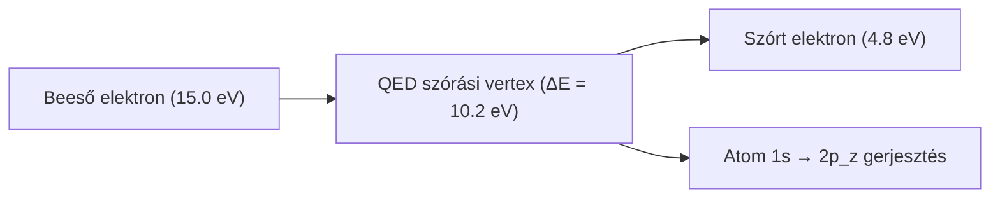

# 2. Szórási Kontínuum, QED Vertex és Lyman-α Emisszió

Ez a dokumentum a 0. szintet (Szórási és sugárzási kontínuum: $\sim 10^{-8} - 10^{-10}\,\mathrm{m}$) és az 1. szint közötti kölcsönhatást, a 6 fázisú dinamikai folyamat elektromágneses mechanizmusát tárgyalja.

---

## Elméleti Besorolás

- [Standard Fizika / Elfogadott Elmélet] — Kvantum-elektrodinamika (QED), Franck–Hertz szórás, dipól kiválasztási szabályok, spontán emisszió és foton hullámhossz.
- [Szemléltető Metafora] — Az animáció arany színű virtuális csomóponti fénycérnái és a leágazási ábrák.

---

## 1. A Szórási Kontínuum és a Franck–Hertz Mechanizmus

[Standard Fizika / Elfogadott Elmélet]

Egy szabad elektron kinetikai energiája a kontínuumban bármekkora értéket felvehet ($E \in [0, \infty)$). Amikor az elektron egy atom közelébe érkezik, két alapvető szórási típus játszódhat le:
1. **Rugalmas szórás (Coulomb / Rutherford):** Az elektron csak mozgásirányt változtat a mag elektrosztatikus terében, a belső energiája és az atom állapota változatlan marad.
2. **Rugalmatlan szórás (Franck–Hertz mechanizmus):** Ha az elektron mozgási energiája eléri a kötött állapotok közötti diszkrét gerjesztési küszöböt, kinetikai energiájának egy részét átadhatja az atomnak:

$$e^-_{\text{in}}(E_{\text{kin}}) + \text{Atom}(1s) \longrightarrow e^-_{\text{out}}(E_{\text{kin}} - \Delta E) + \text{Atom}^*(2p_z)$$

A szimulációnkban a beeső elektron energiája:
- $E_{\text{kin, in}} = 15{,}0\,\mathrm{eV}$
- Szükséges gerjesztési energia: $\Delta E_{1s \to 2p} = -3{,}4\,\mathrm{eV} - (-13{,}6\,\mathrm{eV}) = 10{,}2\,\mathrm{eV}$
- A távozó szórt elektron kinetikus energiája: $E_{\text{kin, out}} = 15{,}0 - 10{,}2 = 4{,}8\,\mathrm{eV}$

---

## 2. A QED Szórási Vertex és a Virtuális Fotonok Fizikája

### Négyesimpulzus-átadás ($Q^2$)
[Standard Fizika / Elfogadott Elmélet]

A kölcsönhatás során kicserélt virtuális foton négyesimpulzusa:

$$q^\mu = p_{\text{in}}^\mu - p_{\text{out}}^\mu = \left( \frac{\Delta E}{c}, \, \vec{q} \right)$$

A virtuális részecske **off-shell** (nincs a tömeghéjon):

$$q^2 = q_\mu q^\mu = \frac{(\Delta E)^2}{c^2} - \lvert\vec{q}\rvert^2 \neq 0$$

A térelméletben a tér-szerű (space-like) impulzusátadást $Q^2 \equiv -q^2 > 0$ jelöli:

$$Q^2 = \lvert\vec{q}\rvert^2 - \frac{(\Delta E)^2}{c^2} > 0$$

Kis szórási szögeknél és atomi energiáknál $Q^2 \sim 0{,}04\,\mathrm{eV}^2/c^2$, ami igazolja a téreszerű Coulomb-csatolást.

### Feynman-propagátor
[Standard Fizika / Elfogadott Elmélet]

A QED-ben a kölcsönhatást a fotonmező Feynman-propagátora közvetíti:

$$D_F(x - y) = \int \frac{d^4 q}{(2\pi)^4} \frac{-i \eta_{\mu\nu}}{q^2 + i\epsilon} \, e^{-i q \cdot (x - y)}$$

A kölcsönhatás nem azonnali távolbahatás, hanem a kvantummező propagálása, amely az atomi fázishullámban rezonáns gerjesztést kelt.

### Virtuális foton mint szemléltető híd
[Szemléltető Metafora]

A vizualizációban az elektron és az atommag közötti virtuális fotoncsere arany pulzáló fénycérnaként jelenik meg, jelezve a Coulomb-erő mező-természetét és az energia ideiglenes csatornázódását.

---

## 3. A Kvantumugrás és a Kiválasztási Szabályok ($1s \to 2p_z$)

[Standard Fizika / Elfogadott Elmélet]

Az atom nem gerjesztődhet tetszőleges állapotba. Az egyfotonos elektromos dipól (E1) átmeneteket az impulzusmomentum-megmaradás szigorúan szabályozza:

$$\Delta l = \pm 1, \quad \Delta m = 0, \pm 1$$

- **Miért tiltott az $1s \to 2s$?** Az $1s$ állapotban $l = 0$, a $2s$-ben szintén $l = 0$. Mivel $\Delta l = 0$, a foton által hordozott $1\hbar$ spin nem konzerválódhat. Az $1s \to 2s$ átmenet egyszeres fotoncserével **szigorúan dipól-tiltott**!
- **Miért a $2p_z$ valósul meg?** A szórási impulzus tengelyét tekintve kvantálási iránynak ($z$-tengely), az átmenet $\Delta l = +1$ és $\Delta m = 0$, amely pontosan a kétlebenyű $2p_z$ orbitált gerjeszti:

$$\psi_{2p_z}(r,\theta,\phi) = \frac{1}{4\sqrt{2\pi a_0^3}} \frac{r}{a_0} e^{-r/(2a_0)} \cos\theta$$

Az orbitális elektronfelhő gömbi szimmetriája felbomlik, és dipólussá alakul.

---

## 4. Spontán Relaxáció és Valós Lyman-α Emisszió

[Standard Fizika / Elfogadott Elmélet]

A gerjesztett $2p_z$ állapot nem stabil; a vákuum zérusponti fluktuációi miatt spontán emisszióval visszatér az $1s$ alapállapotba.

### Einstein-féle átmeneti valószínűség ($A_{21}$):
$$A_{21} = \frac{4\alpha \omega_{21}^3}{3 c^2} \left|\langle 1s \vert \vec{r} \vert 2p_z \rangle\right|^2 \approx 6{,}27 \times 10^8\,\mathrm{s}^{-1}$$

A gerjesztett állapot átlagos élettartama:

$$\tau = \frac{1}{A_{21}} \approx 1{,}60\,\mathrm{ns}$$

### A kisugárzott valós Lyman-α foton jellemzői:
Az emisszió során keletkező foton **valós, tömeghéjon lévő** részecske ($q^2 = 0$):
- **Hullámhossz:**
  $$\lambda = \frac{h c}{\Delta E} = \frac{1239{,}84\,\mathrm{eV}\cdot\,\mathrm{nm}}{10{,}2\,\mathrm{eV}} = 121{,}567\,\mathrm{nm}$$
- **Tartomány:** Vákuum-ultraibolya (VUV).
- **Fotonimpulzus:** $p_\gamma = \frac{\Delta E}{c} \approx 5{,}444 \times 10^{-27}\,\mathrm{kg}\cdot\,\mathrm{m/s}$.

---

## 5. Zárt Energiamérleg (A Megmaradás Főkönyve)

[Standard Fizika / Elfogadott Elmélet]

A teljes folyamat minden ponton egzaktul megőrzi az energiát és a lendületet:

### I. Gerjesztési fázis (Bejövő mérleg):
$$\underbrace{15{,}0\,\mathrm{eV}}_{\text{Beeső elektron kinetikus}} = \underbrace{4{,}8\,\mathrm{eV}}_{\text{Szórt elektron kinetikus}} + \underbrace{10{,}2\,\mathrm{eV}}_{\text{Atom belső gerjesztése } (1s \to 2p_z)}$$

### II. Relaxációs fázis (Kimenő mérleg):
$$\underbrace{10{,}2\,\mathrm{eV}}_{\text{Tárolt belső atomi gerjesztés}} = \underbrace{10{,}199999991\,\mathrm{eV}}_{\text{Valós Lyman-}\alpha\text{ foton}} + \underbrace{8{,}86 \times 10^{-9}\,\mathrm{eV}}_{\text{Mag visszalökődési mozgási energiája}}$$

A visszalökődési energia ($E_R = \frac{p_\gamma^2}{2 M_{\text{mag}}} \approx 8{,}86\,\mathrm{neV}$) elhanyagolható a foton $10{,}2\,\mathrm{eV}$-jához képest, de az impulzusmegmaradás szempontjából alapvető.

---

## 6. Kapcsolódó Dokumentumok és Navigáció

- [01. Kvantummechanika, Elektronhéjak és Atomi Stabilitás](01-kvantum-es-atom.md)
- [03. Nukleon Belső, Magerők és Részecskestruktúra](03-nukleon-es-parton.md)
- [04. Gravitáció, Téridő-görbület és a Vákuumszőnyeg Dinamikája](04-gravitacio-es-vakuum.md)
- [05. A Deák-tér és az Egységes Tér-Gravitáció Elmélet](05-deak-ter-es-egyseges-elmelet.md)
- [06. Magasabb Dimenziók, Topológia és Különleges Jelenségek](06-topologia-es-kulonleges-jelensegek.md)
- [Vissza a Fizikai-Matematikai Modell Összegzőhöz](../physics.md)
