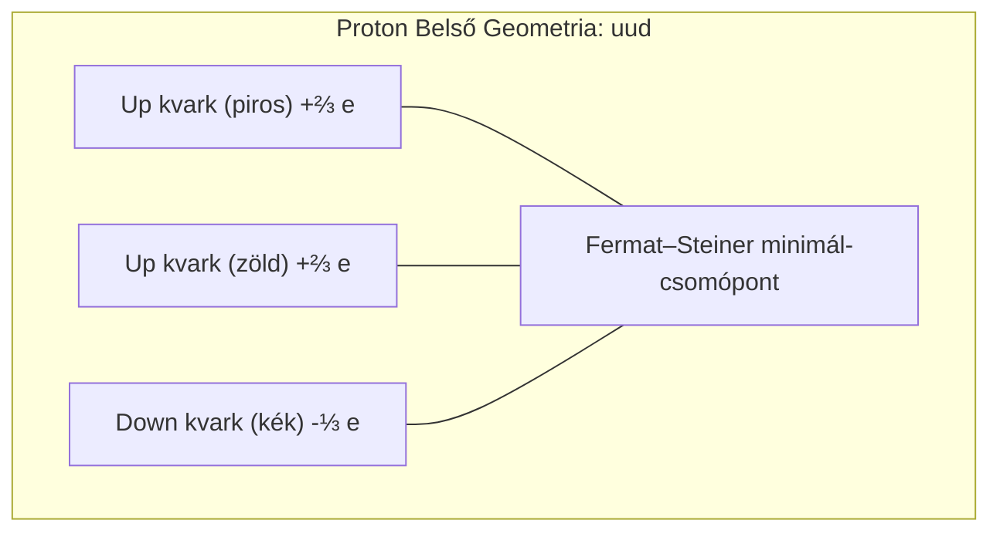

# 3. Nukleon Belső, Magerők és Részecskestruktúra

Ez a dokumentum a rendszer mélyebb szubatomos szintjeit tárgyalja: az 1.5. szintet (Nukleáris kollektív héjszint: $\sim 10^{-14}\,\mathrm{m}$), a 2. szintet (Nukleon belső folyamatok: $\sim 10^{-15}\,\mathrm{m}$) és a 2.5. szintet (Parton szint és mélyen rugalmatlan szórás: $\sim 10^{-16} - 10^{-18}\,\mathrm{m}$).

---

## Elméleti Besorolás

- [Standard Fizika / Elfogadott Elmélet] — Kvantum-színdinamika (QCD), SU(3) szín-bezárás, Yukawa-pioncsere, aszimptotikus szabadság, Bjorken-skálázás, Mössbauer-effektus és Debye–Waller faktor.
- [Szemléltető Metafora] — Az Y-alakú mechanikusnak ható színcsövek 3D Three.js vizuális csőhálózatként való ábrázolása és a forgó szín-gömbök.

---

## 1. Az Atommag Kollektív Héjszerkezete és a Yukawa-potenciál (1.5. Szint)

[Standard Fizika / Elfogadott Elmélet]

Az atomhéj és az egyedi nukleonok között az egész atommag mint kollektív fermion-soktest rendszer helyezkedik el.

### A Yukawa-féle mezoncsere mechanizmus
A protonok és neutronok közötti reziduális erős magerőt a virtuális pionok ($\pi^0, \pi^+, \pi^-$, tömegük $m_\pi \approx 139{,}6\,\mathrm{MeV}/c^2$) cseréje közvetíti:

$$V_{\text{Yukawa}}(r) = - \frac{g_\pi^2}{4\pi} \frac{e^{-\mu r}}{r}, \quad \mu = \frac{m_\pi c}{\hbar} \approx (1{,}4\,\mathrm{fm})^{-1}$$

- **Vonzó tartomány ($0{,}8\,\mathrm{fm} < r < 2{,}5\,\mathrm{fm}$):** A vonzás tartja össze a pozitív protonokat a Coulomb-taszítás ellenére.
- **Kemény mag taszítás (Hard Core, $r < 0{,}5\,\mathrm{fm}$):** A kvarkok Pauli-elvből fakadó átfedési tiltása és a nehezebb vektorbozonok ($\omega, \rho$) cseréje miatt a magerő rendkívül erősen taszítóvá válik ($V \to +\infty$). Ez garantálja a maganyag telítettségét: a nukleáris anyagsűrűség univerzálisan konstans:

$$\rho_0 \approx 0{,}16\,\mathrm{nukleon/fm}^3 \approx 2{,}7 \times 10^{17}\,\mathrm{kg/m}^3$$

### Visszalökődési dinamika
Amikor a héj elektronja szórást szenved vagy fotont bocsát ki, az atommag egészként mozdul el:

$$\Delta\vec{p}_{\text{mag}} = - \vec{q}$$

A Yukawa-csere rezgésbe jön, disszipálva a hirtelen impulzustöbbletet.

---

## 2. A Nukleon Belseje és a Kvantum-színdinamika (2. Szint)

[Standard Fizika / Elfogadott Elmélet]

A proton és a neutron nem elemi részecskék, hanem az erős kölcsönhatás által összetartott hadronok (barionok).

### Kvantumszámok és töltések:
- **Proton ($uud$):** Két up kvark ($+2/3 e$) és egy down kvark ($-1/3 e$). Eredő töltés: $+1 e$.
- **Neutron ($udd$):** Egy up kvark ($+2/3 e$) és két down kvark ($-1/3 e$). Eredő töltés: $0 e$.

### SU(3) Szín-szimmetria és Szín-bezárás (Color Confinement):
A kvarkok nem létezhetnek szabadon a természetben. A mértékcsoport az $SU(3)_C$, ahol a töltések a három színállapot: piros ($R$), zöld ($G$) és kék ($B$).
- Minden megfigyelhető részecskének **szín-semlegesnek (fehérnek)** kell lennie:

$$\vert \text{Barion} \rangle = \frac{1}{\sqrt{6}} \epsilon_{ijk} \vert q^i q^j q^k \rangle$$

### Y-alakú gluon-fluxustubusok:
Az Abel-féle QED-vel szemben a QCD mértékbozonjai (a 8 gluon) maguk is hordoznak színtöltést, így önkölcsönhatásba lépnek. Emiatt az erővonalak nem oszlanak szét a térben, hanem **vékony fluxustubusokká húzódnak össze**. A 3 kvark közötti energia-minimalizálást egy Fermat–Steiner-féle Y-alakú háromágú csőhálózat biztosítja, amelynek húzóereje a távolsággal nem csökken:

$$\kappa \approx 1\,\mathrm{GeV/fm} \approx 160\,000\,\mathrm{N}$$

---

## 3. Parton Szint és Mélyen Rugalmatlan Szórás (2.5. Szint)

[Standard Fizika / Elfogadott Elmélet]

Ha az atomot nagy virtuális energiájú elektronnal szondázzuk ($Q^2 \gg 1\,\mathrm{GeV}^2$), a virtuális foton de Broglie hullámhossza ($\lambda \ll 1\,\mathrm{fm}$) sokkal kisebbé válik, mint maga a proton.

### Bjorken-skálázás és Aszimptotikus Szabadság
David Gross, Frank Wilczek és David Politzer (Nobel-díj 2004) kimutatták, hogy kis távolságokon a QCD csatolási állandója logaritmikusan nullához tart:

$$\alpha_s(Q^2) = \frac{12\pi}{(33 - 2 n_f) \ln(Q^2 / \Lambda_{\text{QCD}}^2)} \xrightarrow{Q^2 \to \infty} 0$$

A kvarkok a proton belsejében quasi-szabad, pontszerű részecskékként (partonokként) viselkednek. A megütött partont a Bjorken-skálaparaméter jellemzi:

$$x_{\text{Bj}} \equiv \frac{Q^2}{2 P \cdot q} = \frac{Q^2}{2 M \nu} \in (0, 1]$$

ahol $x_{\text{Bj}}$ az a lendület-frakció, amelyet a kibocsátott gluonok és a fluktuáló virtuális kvark-antikvark tenger ($u\bar{u}, d\bar{d}, s\bar{s}$) mellett az eltalált kvark hordoz.

---

## 4. Nukleáris Rezonancia Fluoreszcencia (NRF) és a Mössbauer-effektus

[Standard Fizika / Elfogadott Elmélet]

Míg az atomi héjakon a dipól-gerjesztések $1 - 100\,\mathrm{eV}$ energiájúak, addig a nukleáris héj gerjesztése $10\,\mathrm{keV} - 20\,\mathrm{MeV}$ közötti gamma-fotonokat igényel.

### A szabad magok rezonancia-kudarca
Egy $E_0$ energiájú foton kibocsátásakor vagy elnyelésekor a mag visszalökődési mozgási energiát kap:

$$E_R = \frac{E_0^2}{2 M c^2}$$

- **Atomi hidrogén ($10{,}2\,\mathrm{eV}$):** $E_R \approx 8{,}86\,\mathrm{neV}$, miközben a természetes vonalszélesség $\Gamma \approx 410\,\mathrm{neV}$. Mivel $2 E_R \ll \Gamma$, a vonalak átfednek, az atomi fluoreszcencia szabad gázban is lezajlik.
- **Szabad Fe-57 mag ($14{,}41\,\mathrm{keV}$):** $E_R \approx 1{,}96\,\mathrm{meV}$, miközben $\Gamma \approx 4{,}67\,\mathrm{neV}$. Az eltolódás:

$$\frac{2 E_R}{\Gamma} \approx \frac{3{,}92 \times 10^{-3}\,\mathrm{eV}}{4{,}67 \times 10^{-9}\,\mathrm{eV}} \approx 840\,000$$

A kibocsátott és elnyelt vonalak közötti távolság csaknem egymilliószorosa a vonalszélességnek! Szabad atommagok esetén a visszalökődés teljességgel megsemmisíti a rezonanciát.

### A Mössbauer-effektus (Szilárdtest kollektív visszalökődésmentesség)
Rudolf Mössbauer (1958) felfedezte, hogy ha a mag kristályrácsba ágyazódik, a visszalökődési impulzust az **egész makroszkopikus kristály** veszi fel kollektíven:

$$M_{\text{eff}} \sim 10^{20} M_{\text{mag}} \implies E_{R,\text{eff}} \approx 0$$

A visszalökődésmentes hányadot a **Debye–Waller faktor** adja:

$$f = \exp\left( - k_\gamma^2 \langle x^2 \rangle \right)$$

Fe-57 esetén szobahőmérsékleten is $f \approx 0{,}75 - 0{,}80$. A rezonancia-hatáskeresztmetszet elérheti a:

$$\sigma_0 \approx 2{,}56 \times 10^{-22}\,\mathrm{m}^2 = 2{,}56\,\mathrm{Mbarn}$$

értéket, amely a legélesebb spektrális felbontást nyújtja a fizikában ($\Gamma / E_0 \approx 3{,}24 \times 10^{-13}$).

---

## 5. Kapcsolódó Dokumentumok és Navigáció

- [01. Kvantummechanika, Elektronhéjak és Atomi Stabilitás](01-kvantum-es-atom.md)
- [02. Szórási Kontínuum, QED Vertex és Lyman-α Emisszió](02-szoras-es-qed.md)
- [04. Gravitáció, Téridő-görbület és a Vákuumszőnyeg Dinamikája](04-gravitacio-es-vakuum.md)
- [05. A Deák-tér és az Egységes Tér-Gravitáció Elmélet](05-deak-ter-es-egyseges-elmelet.md)
- [06. Magasabb Dimenziók, Topológia és Különleges Jelenségek](06-topologia-es-kulonleges-jelensegek.md)
- [Vissza a Fizikai-Matematikai Modell Összegzőhöz](../physics.md)
