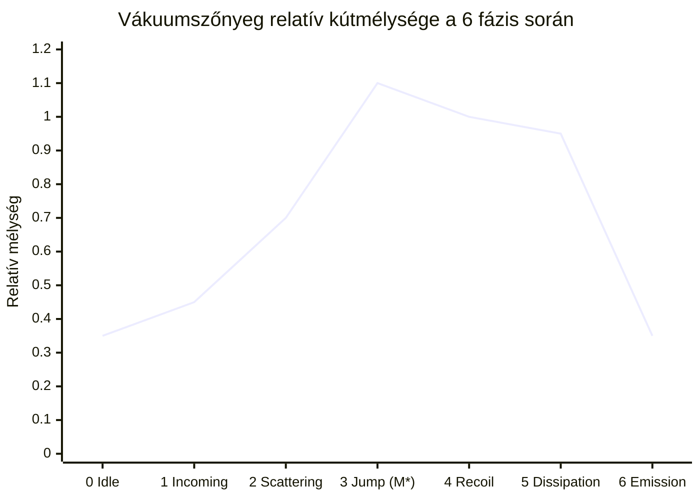
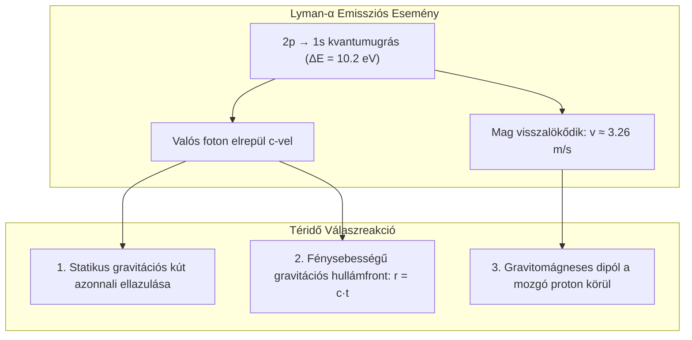
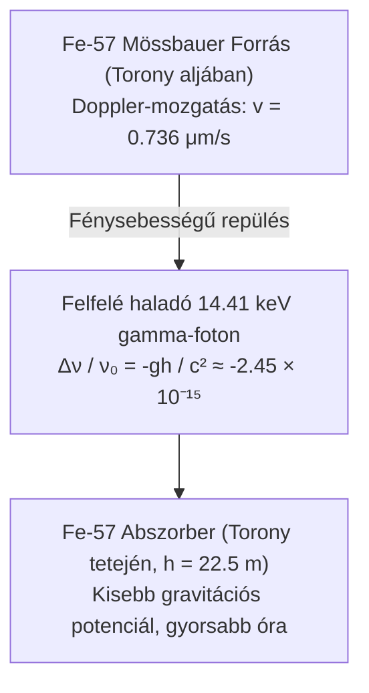

# 4. Gravitáció, Téridő-görbület és a Vákuumszőnyeg Dinamikája

Ez a dokumentum a 3D WebGL szimuláció gravitációs hátterét, az Általános Relativitáselmélet linearizált téregyenleteit, a vákuumszőnyeg megereszkedését ($\delta g_{00}$), a Lyman-α emisszió gravitációs hullámfrontját, a Pound–Rebka kísérletet és a gravitációs hatásirány megváltoztathatóságának elméleti vizsgálatát mutatja be.

---

## Elméleti Besorolás

- [Standard Fizika / Elfogadott Elmélet] — Einstein-féle Általános Relativitáselmélet, linearizált gravitáció (weak-field limit), tömeg-energia ekvivalencia ($E = M c^2$), Pound–Rebka gravitációs vöröseltolódás, Eddington sugárnyomás.
- [Modell-specifikus Hipotézis] — Szaharov-féle indukált vákuumrugalmasság mikrofizikai levezetése, makroszkopikus Casimir-taszítás.
- [Szemléltető Metafora] — A vákuumszőnyeg kék poláris rácshálóként való 3D-s megereszkedése és a gravitációs hullámgyűrűk vizuális fodrozódása.

---

## 1. Linearizált Gravitáció és a Vákuumszőnyeg Metrikája ($\delta g_{00}$)

[Standard Fizika / Elfogadott Elmélet]

Az Einstein-féle téregyenletek:

$$G_{\mu\nu} \equiv R_{\mu\nu} - \frac{1}{2} R g_{\mu\nu} = \frac{8\pi G}{c^4} T_{\mu\nu}$$

Mivel egyetlen mikroszkopikus atom gravitációs tere rendkívül gyenge, a metrika a sík Minkowski-tér kis perturbációjaként tárgyalható:

$$g_{\mu\nu} = \eta_{\mu\nu} + h_{\mu\nu}, \quad \lvert h_{\mu\nu}\rvert \ll 1$$

Lorenz-mértékben ($\partial_\mu \bar{h}^{\mu\nu} = 0$, ahol $\bar{h}_{\mu\nu} = h_{\mu\nu} - \frac{1}{2}\eta_{\mu\nu} h$) az Einstein-egyenlet d'Alembert-féle hullámegyenletté válik:

$$\Box \bar{h}_{\mu\nu} = -\frac{16\pi G}{c^4} T_{\mu\nu}$$

### A vákuumszőnyeg kitérése ($\delta g_{00}$):
A 3D WebGL alkalmazásban a vákuumszőnyeg függőleges süllyedése egzaktul a metrika idő-idő komponensének deformációját jeleníti meg:

$$g_{00}(\vec{r}, t) \approx -\left( 1 + \frac{2\Phi(\vec{r}, t)}{c^2} \right) \implies \delta g_{00}(\vec{r}, t) = -\frac{2\Phi(\vec{r}, t)}{c^2} = +\frac{2 G M_{\text{atom}}(t)}{c^2 r}$$

ahol $\Phi(\vec{r}, t)$ a gravitációs potenciál. A negatív potenciálkút ($\Phi < 0$) a szőnyegen lefelé mutató megereszkedésként jelenik meg.

---

## 2. Az Atom Dinamikus Gravitációs Tömege és a Kútmélység Változása

[Standard Fizika / Elfogadott Elmélet]

Az Einstein-féle ekvivalencia-elv ($E = M c^2$) alapján a gravitáló tömeg nem pusztán a részecskék nyugalmi tömegeinek összege, hanem magában foglalja az elektrodinamikai kötési és gerjesztési energiát is:

$$M_{\text{atom}}(t) = m_p + m_e + \frac{E_{\text{elektron}}(t)}{c^2}$$

### A) Alapállapotban (1s):
$$M_0 = m_p + m_e - \frac{13{,}6057\,\mathrm{eV}}{c^2} \approx 1{,}673557 \times 10^{-27}\,\mathrm{kg}$$

### B) Gerjesztett állapotban (2p):
$$M^* = M_0 + \frac{10{,}2\,\mathrm{eV}}{c^2} \approx M_0 + 1{,}818 \times 10^{-35}\,\mathrm{kg}$$

A tömeg relatív növekedése:

$$\frac{\Delta M}{M_0} = \frac{1{,}818 \times 10^{-35}\,\mathrm{kg}}{1{,}6736 \times 10^{-27}\,\mathrm{kg}} \approx 1{,}086 \times 10^{-8}$$

Bár ez a növekedés a hétköznapi mérésekhez képest parányi, elvi szinten azt jelenti, hogy **a gerjesztett atom gravitációs kútja mélyebb**, mint az alapállapotú atomé!

### Fázisonkénti gravitációs eseménynapló:
1. **0. Fázis (Alapállapot):** Nyugodt, stabil szimmetrikus gravitációs kút ($M_0$).
2. **1. Fázis (Beeső elektron):** Két kút létezik a térben: az atom $M_0$ kútja és a szabad elektron mozgó kútja ($m_e + 15\,\mathrm{eV}/c^2$). Ahogy közelednek, a két kút elkezd egymásba simulni.
3. **2. Fázis (QED vertex):** A virtuális foton átadja a $10{,}2\,\mathrm{eV}$-ot. A szórt elektron kútja sekélyebbé válik és eltávolodik, miközben az atom kútja mélyülni kezd.
4. **3. Fázis (Kvantumugrás, $1s \to 2p_z$):** **A gravitációs kút eléri a maximális mélységét ($M^*$).** Az orbitál dipól jellege miatt a kút enyhén elliptikussá válik a $z$-tengely mentén.
5. **4. Fázis (Nukleáris visszalökődés):** Az atommag ellenmozgást végez ($v \approx 3{,}26\,\mathrm{m/s}$), ami a gravitációs kút centrumának parányi oszcillációját váltja ki.
6. **5. Fázis (Mélységi disszipáció):** A kút mély marad, a felületén felerősödnek a zérusponti kvantumfluktuációk (ZPE).
7. **6. Fázis (Spontán emisszió):** **A szőnyeg felpattan és kisimul!** A foton elviszi a $10{,}2\,\mathrm{eV}$ energiát, a kút visszaugrik az alapállapoti $M_0$ szintre, és egy kifelé futó gravitációs hullámgyűrű indul el.

---

## 3. A Lyman-α Fotonkibocsátás Gravitációs Következményei

[Standard Fizika / Elfogadott Elmélet]

Amikor a 6. fázisban az atom kibocsátja a fotont, a gravitációs térben három egyidejű folyamat zajlik le:

### 1. A gravitációs kút ellazulása:
Az atom invariáns tömege hirtelen lecsökken $\Delta M = -1{,}818 \times 10^{-35}\,\mathrm{kg}$-mal. A helyi görbület azonnal csökken, a vákuumszövet megkönnyebbül.

### 2. A fénysebességű hullámfront (Retardáció):
A gravitációs információ nem terjedhet végtelen sebességgel ($v = c$). A kibocsátástól számított $t$ időpillanatban egy $r = c t$ sugarú gömbhullám választja el a két állapotot:
- **A hullámfront előtt ($r > c t$):** A tér még a nehezebb gerjesztett atom gravitációs terét érzi ($M^*$).
- **A hullámfront mögött ($r < c t$):** A tér már kisimult az alapállapoti szintre ($M_0$).
- **A határon ($r = c t$):** Fénysebességű metrikus hullámfront halad át a vákuumon.

### 3. Nukleáris visszalökődés és gravitomágnesesség:
A távozó foton lendülete miatt a proton visszalökődési sebessége:

$$v_{\text{recoil}} = \frac{p_\gamma}{m_p} = \frac{10{,}2\,\mathrm{eV} / c}{m_p} \approx 3{,}255\,\mathrm{m/s}$$

A mozgó tömegáram ($T_{0i} = \rho v_i$) egy gyenge **gravitomágneses dipólteret** indukál a visszalökődés tengelye körül (Lense–Thirring analógia).

---

## 4. Gravitációs Hatásnagyságrendek: Atomi vs. Nukleáris

A tömeg-energia ekvivalencia révén a magfizikai szintek sokkal erősebben torzítják a téridőt, mint a héj elektronjai:

| Rendszer | Átmeneti energia | Tömegtöbblet ($\Delta M$) | Nyugalmi tömeg ($M_0$) | Relatív hatás ($\Delta M / M_0$) | Szorzó a H-atomhoz képest |
| :--- | :--- | :--- | :--- | :--- | :--- |
| **Atomi H (Lyman-α)** | $10{,}2\,\mathrm{eV}$ | $1{,}82 \times 10^{-35}\,\mathrm{kg}$ | $1{,}67 \times 10^{-27}\,\mathrm{kg}$ | $1{,}09 \times 10^{-8}$ | **$1\times$ (Bázis)** |
| **Nukleáris Fe-57 (Mössbauer)** | $14{,}41\,\mathrm{keV}$ | $2{,}57 \times 10^{-32}\,\mathrm{kg}$ | $9{,}45 \times 10^{-26}\,\mathrm{kg}$ | $2{,}72 \times 10^{-7}$ | **$\approx 25\times$** |
| **Nukleáris C-12 (NRF nívó)** | $15{,}11\,\mathrm{MeV}$ | $2{,}69 \times 10^{-29}\,\mathrm{kg}$ | $1{,}99 \times 10^{-26}\,\mathrm{kg}$ | $1{,}35 \times 10^{-3}$ | **$\approx 124\,500\times$ (0,135%!)** |

Míg az atomi gerjesztésnél a gravitációs kút modulációja csak tízmilliomod rész, addig a nagyenergiás C-12 maggerjesztésnél a mag tömegének több mint **egy ezreléke** modulálódik dinamikusan!

---

## 5. A Pound–Rebka Kísérlet és a Gravitációs Vöröseltolódás

[Standard Fizika / Elfogadott Elmélet]

Robert Pound és Glen Rebka (1959–1960) a Harvard Egyetem Jefferson-tornyában ($h = 22{,}5\,\mathrm{m}$) közvetlenül kimérte a Föld gravitációs vöröseltolódását.

A gravitációs frekvenciaeltolódás:

$$\frac{\Delta\nu_g}{\nu_0} = \frac{g h}{c^2} \approx \frac{9{,}807 \times 22{,}5}{(2{,}998 \times 10^8)^2} \approx 2{,}454 \times 10^{-15}$$

Ezt az elképzelhetetlenül finom eltolódást a forrás mechanikai mozgatásával, lineáris Doppler-eltolódással kompenzálták:

$$\frac{v}{c} = \frac{g h}{c^2} \implies v = \frac{g h}{c} \approx 0{,}736\ \mu\,\mathrm{m/s}$$

A forrás mindössze $0{,}736$ mikrométer per másodperces mozgatása visszaállította a rezonanciát, $1\%$-on belüli pontossággal igazolva Einstein jóslatát.

---

## 6. Megváltoztatható-e a Gravitációs Hatás Iránya? (Kritikai Vizsgálat)

Felmerül az elméleti kérdés: megfordítható-e a gravitációs vonzás iránya (létrehozható-e taszítás / antigravitáció)?

### 1. A kinematikai Doppler-mozgatás nem antigravitáció
[Standard Fizika / Elfogadott Elmélet]

A Pound–Rebka forrás mikrométeres mozgatása nem a Föld gravitációs görbületét fordítja meg, hanem csupán a megfigyelő koordináta-rendszerét transzformálja. A téridő görbülete változatlan marad.

### 2. Makroszkopikus NRF sugárnyomásos lebegtetés
[Standard Fizika / Elfogadott Elmélet]

A Fe-57 Mössbauer-kristály óriási hatáskeresztmetszete ($\sigma_0 \approx 2{,}56\,\mathrm{Mbarn}$) miatt egy alulról irányított koherens gamma-nyalábbal (graser) elérhető az **Eddington-lebegtetés** ($F_{\,\mathrm{rad}} = M g$):

$$I_{\text{crit}} = \frac{M g c}{\sigma_0} \approx 108{,}5\,\mathrm{W/cm}^2$$

Ez valódi makroszkopikus lebegést biztosít, ám ez mechanikai foton-impulzusátadás, nem a gravitációs mező polaritásának megfordulása.

### 3. Valódi téridő-taszítás a térelméletben
[Modell-specifikus Hipotézis]

Ahhoz, hogy maga a gravitációs mező előjele megforduljon ($\delta g_{00} > 0$, gravitációs taszítás), az Einstein-egyenlet szerint negatív energiasűrűségű anyagra lenne szükség. A modellünkben ez kizárólag:
- Makroszkopikus határolt Casimir-vákuummal, vagy
- A Janus-antivilág ($r < 0$) negatív effektív tömegű tükörszektorával értelmezhető. Hétköznapi anyag esetén a gravitáció mindig vonzó.

---

## 7. Kapcsolódó Dokumentumok és Navigáció

- [01. Kvantummechanika, Elektronhéjak és Atomi Stabilitás](01-kvantum-es-atom.md)
- [02. Szórási Kontínuum, QED Vertex és Lyman-α Emisszió](02-szoras-es-qed.md)
- [03. Nukleon Belső, Magerők és Részecskestruktúra](03-nukleon-es-parton.md)
- [05. A Deák-tér és az Egységes Tér-Gravitáció Elmélet](05-deak-ter-es-egyseges-elmelet.md)
- [06. Magasabb Dimenziók, Topológia és Különleges Jelenségek](06-topologia-es-kulonleges-jelensegek.md)
- [Vissza a Fizikai-Matematikai Modell Összegzőhöz](../physics.md)
