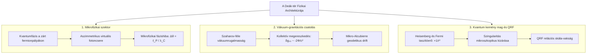
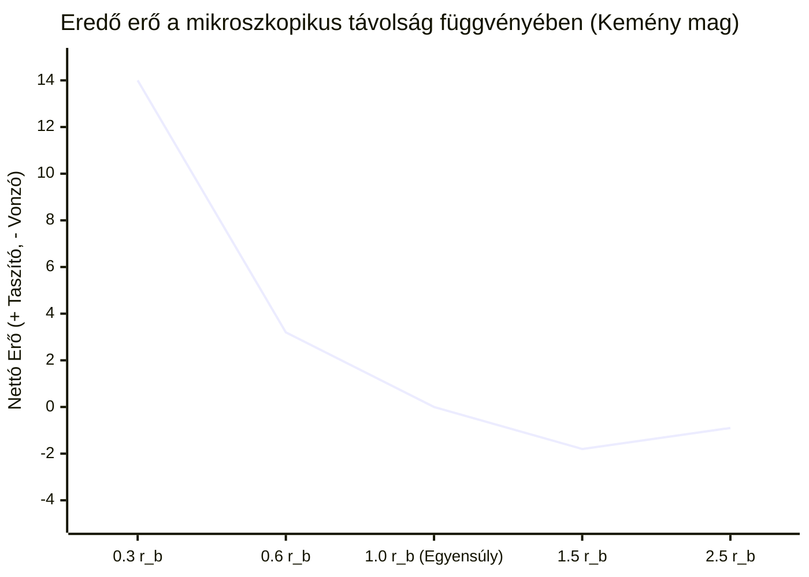

# 5. A Deák-tér és az Egységes Tér-Gravitáció Elmélet

Ez a dokumentum a pedia repóból (`/web/pedia` és `/web/book-of-zaphod`) átemelt és a 3D WebGL szimulációs rendszerhez aktualizált **Deák-tér** és **Egységes Tér-Gravitáció Elmélet** matematikai és fizikai szintézisét tartalmazza.

---

## Elméleti Besorolás

- [Standard Fizika / Elfogadott Elmélet] — Kvantummechanikai határozatlanság, Pauli-féle kizárási elv, Dirac-egyenlet, Lorentz-invariancia, Adler–Visser-féle egyhurkos induktív vákuumhatás.
- [Modell-specifikus Hipotézis] — A Deák-sokaság 5D relációs skálamezeje, a mikrofizikai fázishiba ($\Delta\theta \sim \ell_P / \lambda_C$) által indukált gravitációs állandó ($G$), és a kvantum kemény mag taszító gát ($+1/r^3$).
- [Szemléltető Metafora] — A Deák téri metróátszállási analógia (szintváltás), a kanyarban zsebre tett visszajáró és a kiegyezési belső autonómia.

---

## 1. A Deák-tér Koncepciója és Fizikai Architektúrája

[Modell-specifikus Hipotézis]

A modern elméleti fizikában a **Deák-tér** (vagy *Deák-téridő*) olyan skálakovariáns téridő-modell, amely a standard négydimenziós kontínuumot egy belső relációs skálatengellyel egészíti ki, és a gravitációt a kvantumvákuum rugalmas válaszreakciójaként értelmezi.

### Mi az alapvető újdonság?
A klasszikus általános relativitáselméletben a gravitációs állandó ($G$) egy külső, kísérletileg behelyettesített szám, amely nem magyarázza meg a hierarchia-problémát ($F_G / F_E \sim 10^{-42}$), és pontszerű tömegeknél feloldhatatlan szingularitáshoz vezet.
A Deák-térben:
1. **A gravitáció nem önálló alapmező**, hanem a zárt elektronhéjak és nukleonok kvantumfázis-aszimmetriájából fakadó makroszkopikus vákuum-megereszkedés.
2. **A hierarchia-probléma kvadratikus feloldása:** A $10^{-42}$-es arány a Dirac-tömeg és a Planck-skála közötti egyetlen dimenziótlan arány ($\Delta\theta \sim 10^{-21}$) másodfokú leképezése.
3. **Kvantum kemény mag:** A Heisenberg-határozatlanság és a Pauli-elv $+1/r^3$ taszítóereje gyorsabban nő a vonzásnál, mikroszkopikusan kizárva a szingularitásokat.

---

## 2. A Deák-sokaság Matematikai Struktúrája

[Modell-specifikus Hipotézis]

Legyen $\mathcal{M}^4$ egy sima, négydimenziós Lorentz-sokaság. A **Deák-sokaság** egy 5-dimenziós kiterjesztett relációs állapotsokaság:

$$\mathcal{D}^5 = \mathcal{M}^4 \times \mathbb{R}^+_\rho$$

ahol az 5. koordináta nem egy titokzatos külső térméret (nincsenek gerjeszthető masszív Kaluza–Klein módusai), hanem a **relációs konformális skálaszál** (conformal scale fibre):

$$\rho(x) \equiv \ln\left( \frac{\langle r_{\text{orbit}} \rangle}{a_0} \right)$$

### A kiterjesztett Deák-vonalelem:
$$d\hat{s}^2 = e^{2\sigma(x, \rho)} g_{\mu\nu}(x) dx^\mu dx^\nu + \lambda_C^2 \, d\rho^2$$

Itt:
- $g_{\mu\nu}(x)$ a négydimenziós makroszkopikus pszeudo-Riemann metrika;
- $\lambda_C = \frac{\hbar}{m_e c} \approx 3{,}8616 \times 10^{-13}\,\mathrm{m}$ a redukált Compton-hullámhossz, amely a belső skálatengely kvantumos merevségét adja meg;
- $\sigma(x, \rho)$ a dinamikus skálamező:
  $$\sigma(x, \rho) = - \frac{\Phi_{\text{grav}}(x)}{c^2} + \rho_n$$
  ahol $\rho_n = 2\ln n$ a főkvantumszámhoz tartozó diszkrét Bohr-állapot ($\langle r \rangle_n = a_0 n^2$).

### A Weyl-féle mérhetetlenség feloldása a Dirac-tömeggel:
[Standard Fizika / Elfogadott Elmélet]

Hermann Weyl 1918-as skálaelmélete elbukott, mert tömegtelen mezőknél a skálafaktor mérhetetlen mérték-szabadság volt. A természetben azonban az elektron nyugalmi tömege nem zérus ($m_e \neq 0$), ami miatt a skálainvariancia **fundamentálisan törött szimmetria**:

$$\Theta^\mu_{\ \mu} = m_e c^2 \bar{\psi}\psi \neq 0$$

A fizikai skála tehát nem tetszőleges koordináta-játék, hanem az elektron Dirac-hullámfüggvénye által abszolút módon rögzített valóság.

---

## 3. Miért nincs Éterszél és miért Skálainvariáns a Modell?

[Standard Fizika / Elfogadott Elmélet]

A 19. századi mechanikai éter elbukott, mert feltételezett egy abszolút nyugvó közeget (Michelson–Morley kísérlet). A modern kvantumvákuum azonban:

1. **Lorentz-invariáns energia-impulzus tenzor:**
   $$T_{\mu\nu}^{\text{vac}} = -\rho_{\text{vac}} g_{\mu\nu}$$
   Ez bármilyen Lorentz-transzformációra invariáns: $T'_{\mu\nu} = T_{\mu\nu}$. Nincs kitüntetett „éterszél”, a vákuum minden mozgó megfigyelő számára azonosan nyugvónak látszik.
2. **A Skála-vak megfigyelő tétele (Quantum Reference Frames - QRF):**
   Ha a gravitációs mező megváltoztatja a helyi skálafaktort, a kísérletező saját mérőpálcái (az atomi Bohr-sugarak) és atomórái (az elektron átmeneti frekvenciái) **dinamikusan együtt változnak a háttérrel**. A belső megfigyelő a saját rendszerében nem észlel méretváltozást; a skálaeltolódás kizárólag relációsan, egy másik vonatkoztatási rendszerrel összehasonlítva válik mérhetővé.

---

## 4. Szaharov Indukált Gravitációja és a Newton-állandó ($G$) Mikrofizikai Levezetése

### A Szaharov-hatás
[Standard Fizika / Elfogadott Elmélet]

Andrej Szaharov (1967) felismerése szerint a gravitáció nem egy önálló alapmező, hanem a kvantumvákuum egyensúlyi rugalmassága (elaszticitása). A vákuum Dirac-fluktuációinak egyhurkos (one-loop) integrálásából az Einstein–Hilbert hatás közvetlenül emergál:

$$S_{\text{eff}}[g] = \int d^4 x \sqrt{-g} \left[ - \Lambda_{\text{ind}} + \frac{c^4}{16\pi G_{\text{ind}}} R + \alpha R^2 + \dots \right]$$

### A mikrofizikai fázishiba ($\Delta\theta$)
[Modell-specifikus Hipotézis]

Egy zárt Bohr-pályán ($r \sim a_0$) keringő elektron a Planck-skála felbontási határán ($\ell_P \equiv \sqrt{\frac{\hbar G}{c^3}} \approx 1{,}616 \times 10^{-35}\,\mathrm{m}$) mikroszkopikus fáziskésést szenved. A virtuális foton elnyelési és visszalökési pontja a pályagörbület miatt szöghibát szenved:

$$\Delta\theta \sim \frac{\ell_P}{\lambda_C} \approx \frac{1{,}616 \times 10^{-35}\,\mathrm{m}}{3{,}862 \times 10^{-13}\,\mathrm{m}} \approx 4{,}18 \times 10^{-23}\,\mathrm{rad}$$

Mivel a felvett és leadott virtuális impulzusvektorok nem esnek egy egyenesbe, egy parányi reziduális húzóerő keletkezik:

$$F_{\text{res}} \approx F_E \cdot (\Delta\theta)^2 \sim \frac{e^2}{4\pi\varepsilon_0 a_0^2} \cdot 10^{-44} \sim 10^{-47}\,\mathrm{N} \sim F_G!$$

### A Newton-állandó ($G$) levezetése:
Ha a Planck-hosszt tekintjük a téridő minimális geometriai cellaméretének, a makroszkopikus gravitációs állandó nem egy szabad külső paraméter, hanem az atomi fázishiba statisztikus válaszaként levezethető:

$$G_{\text{ind}} = \frac{c^3 \ell_P^2}{\hbar} \approx 6{,}6743 \times 10^{-11}\,\mathrm{m}^3\,\mathrm{kg}^{-1}\,\mathrm{s}^{-2}$$

Ez feloldja a hierarchia-problémát: a gravitáció azért $10^{42}$-szer gyengébb az elektromágnességnél, mert a fázishiba $(\ell_P / \lambda_C)^2$ négyzetes arányként vetül le a makroszkopikus téridőre!

---

## 5. Kvantum Kemény Mag: A Szingularitások Kizárása

[Standard Fizika / Elfogadott Elmélet] & [Modell-specifikus Hipotézis]

Miért nem omlik össze az anyag végtelen sűrűségű gravitációs szingularitásba?

A Heisenberg-határozatlanság ($p \sim \hbar / r$) kinetikai ellennyomást fejt ki:

$$E_{\text{kin}} \sim \frac{\hbar^2}{2 m r^2} \implies F_{\text{rep}} = -\frac{d E_{\text{kin}}}{dr} = +\frac{\hbar^2}{m r^3}$$

Az eredő erő a vonzó gravitációval vagy Coulomb-erővel:

$$F_{\text{net}} = -\frac{G M m}{r^2} + \frac{\hbar^2}{m r^3}$$

- Nagy távolságokon ($r \gg r_{\text{bounce}}$) a vonzó $-1/r^2$ dominál.
- Kis távolságokon ($r \to 0$) a taszító $+1/r^3$ **mindig legyőzi a gravitációt**, stabil egyensúlyi sugarat hozva létre:

$$r_{\text{bounce}} = \frac{\hbar^2}{G M m^2}$$

Ez a **Heisenberg–Fermi kemény mag**, amely megakadályozza a téridő szingularitásba omlását mind a nukleáris maganyagban, mind a kvarkok belső geometriájában.

---

## 6. Kapcsolat az Információs Geometriával (Greco 2026)

[Modell-specifikus Hipotézis]

Giuseppe Junior Greco (*Cyclic Cosmology from Informational Geometry and Einstein–Cartan Torsion*, 2026) modellje a fenti Deák-tér szintézist összeköti a modern ciklikus kozmológiával:

1. **Információs határfelület (Informational Boundary):**
   A mikro-horizontok nem puszta geometriai csapdák, hanem információs határfelületek. A horizonton belüli események belső koordinátákban valóságosak, de a külső megfigyelő számára soha nem válnak rögzített, közös tényekké (*Esemény–Tény horizont szétválás*).
2. **Információs torzió:**
   Amikor a helyi információs sűrűség túllépi a kritikus korlátot ($\rho_I > \rho_c$), a téridő affin torziós tenzorral válaszol:
   $$\lvert T\rvert \simeq \alpha \lvert\nabla\rho_I\rvert + \beta \Theta(\rho_I - \rho_c)(\rho_I - \rho_c)^\gamma$$
   A torzió taszító feszültsége elhárítja a szingularitást, és nem-szinguláris pattanást (Bounce) indít el.
3. **Hawking-sugárzás mint dekompresszió:**
   A horizont belső magja a multiverzum által lenyesett efemer ágakat tömöríti. A párolgási ciklus során a megszökő partner-részecskék dekompresszálva sugározzák vissza a kvantum-korrelációkat, a folyamat végén stabil Planck-relikviát hagyva hátra.

---

## 7. Kapcsolódó Dokumentumok és Navigáció

- [01. Kvantummechanika, Elektronhéjak és Atomi Stabilitás](01-kvantum-es-atom.md)
- [02. Szórási Kontínuum, QED Vertex és Lyman-α Emisszió](02-szoras-es-qed.md)
- [03. Nukleon Belső, Magerők és Részecskestruktúra](03-nukleon-es-parton.md)
- [04. Gravitáció, Téridő-görbület és a Vákuumszőnyeg Dinamikája](04-gravitacio-es-vakuum.md)
- [06. Magasabb Dimenziók, Topológia és Különleges Jelenségek](06-topologia-es-kulonleges-jelensegek.md)
- [Vissza a Fizikai-Matematikai Modell Összegzőhöz](../physics.md)
