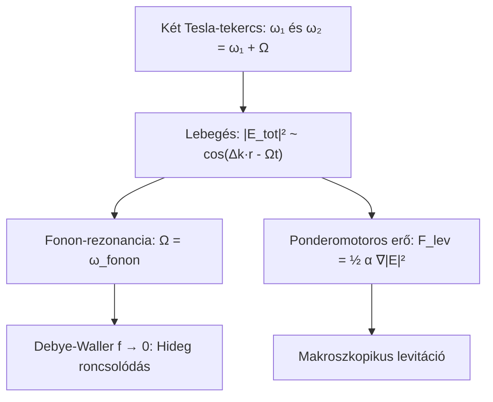

# 6. Magasabb Dimenziók, Topológia és Különleges Jelenségek

Ez a dokumentum a 3. szintet (Kvark belső és mikro-féregjárat: $\sim 10^{-19}\,\mathrm{m} \to \ell_P$), a Janus antianyag tükörvilágot, az extra dimenziók és D-bránok húrelméleti geometriáját, valamint az extrém elektromágneses jelenségeket (Schwinger-effektus és Hutchison-effektus) tárgyalja.

---

## Elméleti Besorolás

- <span style="background-color: #065f46; color: #34d399; padding: 2px 8px; border-radius: 4px; font-weight: bold; font-size: 0.85em;">[Standard Fizika / Elfogadott Elmélet]</span> — Schwinger-effektus, Kerr-metrika és ergociklus, Hawking-sugárzás elmélete, ponderomotoros erő inhomogén EM terekben, Riemann-zéta analitikus folytatás.
- <span style="background-color: #1e3a8a; color: #60a5fa; padding: 2px 8px; border-radius: 4px; font-weight: bold; font-size: 0.85em;">[Modell-specifikus Hipotézis]</span> — D-brán csatolás mikroszkopikus csatornákkal, Calabi–Yau vibrációk mint mélységi gerjesztési csatornák, és a Janus-szektor mint $r < 0$ kiterjesztés.
- <span style="background-color: #581c87; color: #c084fc; padding: 2px 8px; border-radius: 4px; font-weight: bold; font-size: 0.85em;">[Szemléltető Metafora]</span> — A kvark belsejében megjelenő forgó féregjárat-tölcsér, a Calabi–Yau sokaság 3D vetülete és a fénylő gyűrűk.

---

## 1. D-bránok, Nyitott és Zárt Húrok az Extra Dimenziókban

<span style="background-color: #1e3a8a; color: #60a5fa; padding: 2px 8px; border-radius: 4px; font-weight: bold; font-size: 0.85em;">[Modell-specifikus Hipotézis]</span>

A modern húrelméletben (M-elmélet, Randall–Sundrum brán-világok) a klasszikus 4D téridő egy magasabb dimenziós „bulk” térben lebegő 3-brán ($\mathcal{M}^{3+1}$).

```mermaid
flowchart LR
  subgraph BranWorld [Mi 3-Bránunk (Anyagi világ)]
    OpenString["Nyitott húrok (Elektron, kvark)<br/>Végpontok a bránhoz láncolva (Dirichlet)"]
    QEDVertex["QED vertex: leszakadó hurok"]
  end

  subgraph BulkSpace [Magasabb Dimenziós Bulk]
    ClosedLoop["Zárt húrok (Virtuális foton, graviton)<br/>Szabadon utaznak az extra dimenziókban"]
  end

  OpenString --> QEDVertex --> ClosedLoop --> OpenString
```

### Nyitott húrok (Anyagi részecskék):
Az elektronok és kvarkok olyan nyitott húrok, amelyeknek mindkét végpontja Dirichlet-peremfeltételekkel a mi 3-bránunkhoz van kötve:

$$\left. X^\mu(\tau, \sigma) \right|_{\sigma=0, \pi} \in \text{Brán}$$

Ez garantálja, hogy a részecskék nem hagyhatják el a mi terünket, fenntartva az anyagi világ makroszkopikus stabilitását.

### Zárt húrok (Gravitonok és virtuális hurkok):
A zárt hurkok nincsenek a bránhoz rögzítve ($X^\mu(\tau, \sigma + 2\pi) = X^\mu(\tau, \sigma)$). Szabadon beléphetnek az extra dimenziókba, közvetlen utat nyitva a távoli pontok között.

---

## 2. A Kvarkszintű Mikro-féregjárat és a Kerr-Schild Geometria

<span style="background-color: #065f46; color: #34d399; padding: 2px 8px; border-radius: 4px; font-weight: bold; font-size: 0.85em;">[Standard Fizika]</span> & <span style="background-color: #581c87; color: #c084fc; padding: 2px 8px; border-radius: 4px; font-weight: bold; font-size: 0.85em;">[Metafora]</span>

A szimuláció 3. szintjén a kvark magját a forgó Kerr–Newman geometria analógiájával írjuk le. Kerr–Schild koordinátákban a metrika a sík Minkowski-tér perturbációjaként áll elő:

$$g_{\mu\nu} = \eta_{\mu\nu} + H k_\mu k_\nu$$

ahol $k_\mu$ fény-szerű vektor ($k^\mu k_\mu = 0$), a profilfüggvény pedig:

$$H = \frac{2 M r^3 - Q^2 r^2}{r^4 + a^2 z^2}$$

Itt a szingularitás nem pontszerű, hanem egy $a$ sugarú gyűrű az $x$-$y$ síkban:

$$x^2 + y^2 = a^2, \quad z = 0$$

A vizualizációban ez a fénylő Kerr-gyűrű alkotja a mélységi átjáró torkolatát a Calabi–Yau sokaság belső vetülete felé.

---

## 3. Riemann-zéta Regularizáció a Kvantumfizikában

<span style="background-color: #065f46; color: #34d399; padding: 2px 8px; border-radius: 4px; font-weight: bold; font-size: 0.85em;">[Standard Fizika / Elfogadott Elmélet]</span>

A Riemann-féle zéta-függvény:

$$\zeta(s) = \sum_{n=1}^\infty \frac{1}{n^s} = \prod_{p \text{ prím}} \frac{1}{1 - p^{-s}}$$

### Dimenziószámítás a húrelméletben:
A bozonikus húr kritikus dimenzióját ($D = 26$) és a szuperhúrokét ($D = 10$) a vákuumrezgések végtelen módusainak zéta-regularizációja rögzíti:

$$\sum_{n=1}^\infty n = \zeta(-1) = -\frac{1}{12}$$

Ez a regularizált negatív érték garantálja a Lorentz-anomália kioltódását és a Casimir-vákuumenergia végességét.

### Kvantumkaosz és a Montgomery–Odlyzko törvény:
A zéta nemtriviális zérushelyei ($s = 1/2 + i E_n$) statisztikailag tökéletesen megegyeznek egy kaotikus kvantum-Hamilton-operátor sajátértékeivel (Gaussian Unitary Ensemble - GUE mátrixeloszlás), leírva a komplex atommagok rezonanciaszintjeit.

---

## 4. Extrém Terek: A Schwinger-effektus

<span style="background-color: #065f46; color: #34d399; padding: 2px 8px; border-radius: 4px; font-weight: bold; font-size: 0.85em;">[Standard Fizika / Elfogadott Elmélet]</span>

Julian Schwinger (1951) levezette, hogy ha a térben extrém erős elektromos tér van jelen, a vákuumból felpattanó virtuális elektron-pozitron párok a Compton-hullámhossznál ($\lambda_C$) messzebb rántódnak szét:

$$e E \cdot \lambda_C \ge 2 m_e c^2 \implies E_{\text{cr}} = \frac{m_e^2 c^3}{e \hbar} \approx 1{,}32 \times 10^{18}\,\mathrm{V/m}$$

A térfogat- és időegységenkénti párkeltési ráta:

$$\Gamma = \frac{(eE)^2}{4\pi^3 \hbar^2 c} \sum_{n=1}^\infty \frac{1}{n^2} \exp\left( -\frac{n \pi m_e^2 c^3}{e \hbar E} \right)$$

A külső elektromos mező munkát végez a páron, kifizeti az energiahitelt, és a virtuális fluktuáció két valóságos, mérhető részecskévé (elektron és pozitron) kristályosodik ki.

---

## 5. A Janus-antivilág ($r < 0$ Tartomány)

<span style="background-color: #1e3a8a; color: #60a5fa; padding: 2px 8px; border-radius: 4px; font-weight: bold; font-size: 0.85em;">[Modell-specifikus Hipotézis]</span>

A Kerr-metrika teljes analitikus folytatása megengedi az $r < 0$ koordinátatartományt. A szimuláció **Janus Antimatter** szektorában:
- A koordinátatengely megfordul: $\lambda \longleftrightarrow 1/\lambda$,
- Az effektív tömegcsatolás negatív előjelűvé válik: $M_{\text{eff}} = -M$,
- A vákuumszövet nem lefelé süllyed, hanem felfelé boltosul ($\delta g_{00} > 0$),
- A magot egy rubin-vörös antiproton alkotja, amely körül pozitronok keringenek ellenkező irányban.

---

## 6. A Hutchison-effektus Nemlineáris Elektrodinamikája

John Hutchison kanadai kísérletező (1979) nagyfeszültségű Tesla-tekercsek, Van de Graaff generátor és RF sugárzók egyidejű interferenciájával állított elő vitatott makroszkopikus anomáliákat (lebegés, hideg anyagroncsolódás, fémek és fák összeolvadása).

### A Frekvencia-paradoxon
<span style="background-color: #065f46; color: #34d399; padding: 2px 8px; border-radius: 4px; font-weight: bold; font-size: 0.85em;">[Standard Fizika / Elfogadott Elmélet]</span>

Egy $f = 1\,\mathrm{MHz}$-es Tesla-tekercs egyetlen fotonjának energiája mindössze:

$$E_{\text{RF}} = h f \approx 4{,}14 \times 10^{-9}\,\mathrm{eV} = 4{,}14\,\mathrm{neV}$$

Mivel az atomi kötések felszakításához $1 - 10\,\mathrm{eV}$ ($10^9$-szeres), a magreakciókhoz pedig $10\,\mathrm{keV} - 10\,\mathrm{MeV}$ ($10^{13}$-szoros) energia szükséges, **az egyfotonos fotonabszorpció teljességgel kizárt**.

### A Megfelelő Gerjesztés Mechanizmusa
<span style="background-color: #065f46; color: #34d399; padding: 2px 8px; border-radius: 4px; font-weight: bold; font-size: 0.85em;">[Standard Fizika / Elfogadott Elmélet]</span>

A hatás nem az egyedi fotonok energiájából, hanem a két interferáló tekercs nemlineáris térgradienséből fakad:



1. **Lebegési burkoló (Spatial & Temporal Beating):**
   A két közeli frekvenciájú mező szuperpozíciója alacsony frekvenciájú lebegést hoz létre: $\Omega = |\omega_1 - \omega_2|$. Ha ezt a szilárdtest akusztikus vagy optikai fonon-módusaira hangolják ($\Omega \sim 10\,\mathrm{kHz} - 100\,\mathrm{MHz}$), a piezoelektromos feszültségek rezonánsan meghajtják a rácsot.
2. **Debye–Waller összeomlás és hideg roncsolódás:**
   A hajtott rácsrezgések miatt a kitérés ($\langle x^2 \rangle$) átlépi a Lindemann-határt ($\sqrt{\langle x^2 \rangle} \ge 0{,}1 a_0$). A Debye–Waller faktor nullára zuhan ($f \to 0$), a kristályrács belső kohéziója megszűnik: a fém mechanikai szilárdsága összeomlik, és ridegtöréssel szétesik anélkül, hogy felmelegedne!
3. **Ponderomotoros makroszkopikus levitáció:**
   Inhomogén elektromágneses térben a testekre ható időátlagolt gradiens-erő:
   $$\vec{F}_{\text{lev}} = \frac{1}{2} \alpha_{\text{eff}} \nabla \langle \lvert\vec{E}\rvert^2 \rangle$$
   Felfelé mutató térerősség-gradiens esetén a ponderomotoros felhajtóerő kiegyenlítheti a gravitációt ($\vec{F}_{\text{lev}} + M\vec{g} = 0$). Ez makroszkopikus elektrodinamikai lebegtetés, amely az antigravitáció tökéletes illúzióját kelti.

---

## 7. Kapcsolódó Dokumentumok és Navigáció

- [01. Kvantummechanika, Elektronhéjak és Atomi Stabilitás](01-kvantum-es-atom.md)
- [02. Szórási Kontínuum, QED Vertex és Lyman-α Emisszió](02-szoras-es-qed.md)
- [03. Nukleon Belső, Magerők és Részecskestruktúra](03-nukleon-es-parton.md)
- [04. Gravitáció, Téridő-görbület és a Vákuumszőnyeg Dinamikája](04-gravitacio-es-vakuum.md)
- [05. A Deák-tér és az Egységes Tér-Gravitáció Elmélet](05-deak-ter-es-egyseges-elmelet.md)
- [Vissza a Fizikai-Matematikai Modell Összegzőhöz](../physics.md)
