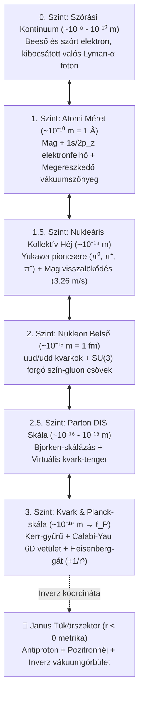
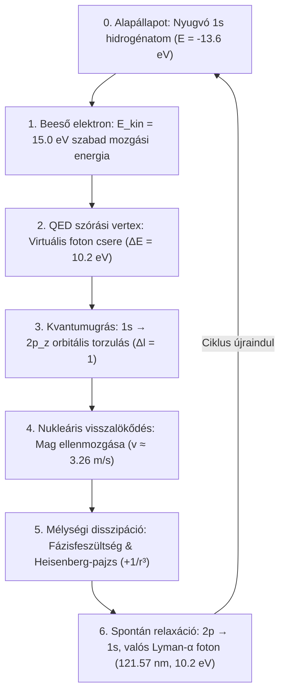
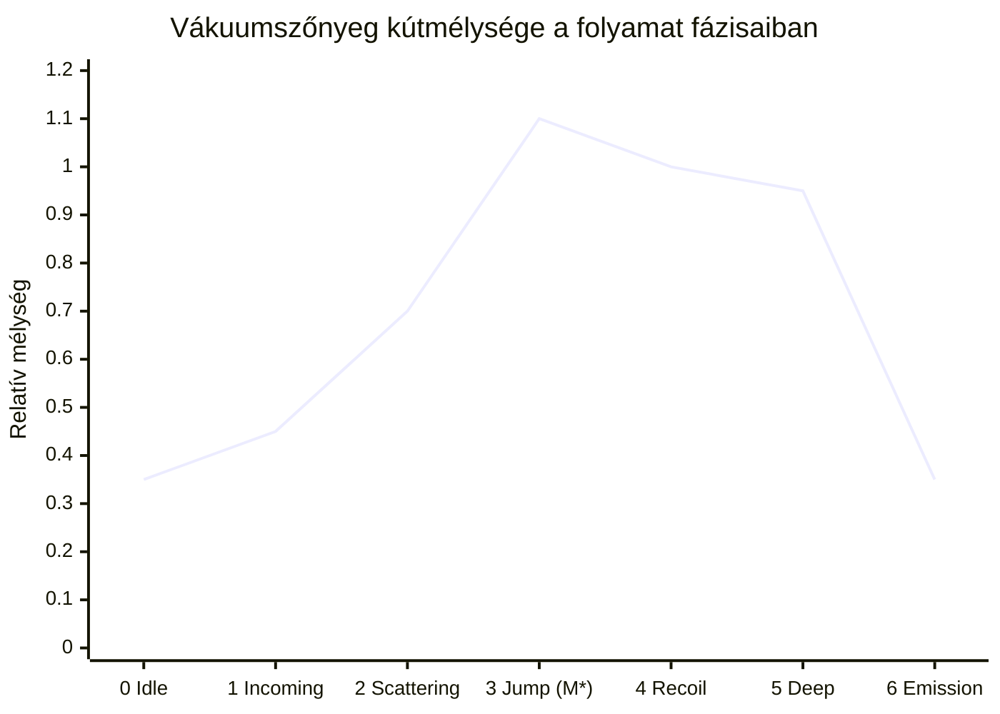

# Egységes Modell-dokumentáció: Atomi Működés, Energiaáramlás és Gravitációs Dinamika

  <h4>⚠️ Figyelem / Tudományos Nyilatkozat</h4>
  

    Ez a projekt egy <strong>gondolatindító, vázlatos vizualizáció</strong>, amely egy fejlettebb projekt előkészítésének első lépése. 
    <strong>Sem az itt leírtakat, sem pedig az animációt nem lehet helyes, fizikailag elfogadott modellként kezelni.</strong> 
    A vizualizáció és a kapcsolódó elméleti leírások gondolatkísérletek és pedagógiai célú didaktikai reprezentációs eszközök; nem minősülnek kísérletileg igazolt tankönyvi fizikának vagy konszenzusos tudományos modellnek.
  

Ez a dokumentum közérthetően, ugyanakkor egzakt fizikai egyenletekkel és térelméleti pontossággal mutatja be a 3D WebGL szimuláció működését: hogyan épül fel a több-skálás hierarchikus rendszer, hogyan áramlik az energia a kvantumfolyamat során, mikor és miért ereszkedik meg a téridő vákuumszőnyege, milyen hatással van a Lyman-α fotonkibocsátás a gravitációra, és hogyan integrálódik a pedia repóból ismert Deák-tér és Egységes Tér-Gravitáció Elmélet.

A teljes, moduláris fizikai és matematikai háttér a [`physics.md`](physics.md) gyűjtőoldalon és annak [tematikus alfejezeteiben](physics.md#a-rendszer-elmeleti-architekturaja) található meg.

---

## Elméleti Besorolás és Módszertan

A dokumentációban az állítások megbízhatóságát és jellegét egységes címkék jelzik:
- [Standard Fizika / Elfogadott Elmélet] — Kísérletileg igazolt kvantummechanika, QED, QCD és Általános Relativitáselmélet.
- [Modell-specifikus Hipotézis] — A projekt térelméleti modellje: Deák-féle 5D relációs skálaszál, Szaharov-indukált gravitáció a kvantumos fázishibából ($\Delta\theta$), és a kvantum kemény mag ($+1/r^3$).
- [Szemléltető Metafora] — 3D WebGL képi analógiák (mikro-féregjárat, Calabi–Yau 3D vetület, arany fotonszálak, Janus tükörszektor).

---

## 1. A Modell Lényege és Dinamikai Ciklusa

[Standard Fizika] & [Modell-specifikus Hipotézis]

A szimuláció egy hidrogénatom zárt dinamikai életciklusát követi nyomon:
1. Egy külső szabad elektron szóródik rajta ($15{,}0\,\mathrm{eV} \to 4{,}8\,\mathrm{eV}$).
2. Az atom elnyeli a $10{,}2\,\mathrm{eV}$ gerjesztési energiát ($1s \to 2p_z$), miközben az atom tömege az ekvivalencia-elv alapján megnő ($\Delta M = 10{,}2\,\mathrm{eV}/c^2$), elmélyítve a téridő gravitációs kútját.
3. A gerjesztett állapot spontán relaxációval ($A_{21} \approx 6{,}27 \times 10^8\,\mathrm{s}^{-1}$) egy fénysebességgel távozó valódi Lyman-α fotont ($121{,}57\,\mathrm{nm}$) bocsát ki.
4. A kút hirtelen felpattan, és egy fénysebességgel táguló gömbhullámú gravitációs hullámfront indul el a téridőben ($r = ct$).

A felhasználó eközben folytonosan vagy lépésenként mozoghat a makroszkopikus atomi mérettől ($\sim 10^{-10}\,\mathrm{m}$) a nukleonon ($\sim 10^{-15}\,\mathrm{m}$) át a kvarkok belső Planck-skálájáig ($\sim 10^{-19}\,\mathrm{m} \to \ell_P$).

---

## 2. A Kiterjesztett Skálahierarchia (Multi-Scale Zoom)

A szintek a [`LevelManager.js`](https://github.com/LowCoders/atom-visualisation/blob/main/src/core/LevelManager.js) architektúrájára és a Deák-tér belső relációs skálatengelyére ($\rho = \ln(r/a_0)$) épülnek:

| Szint megnevezése | Méretskála | Megjelenítés a 3D-ben | Fizikai alap vs. Szemléltetés |
| :--- | :--- | :--- | :--- |
| **0. Szórási kontínuum** | $\sim 10^{-8} - 10^{-10}\,\mathrm{m}$ | Hiperbolikus elektronsugár, Møller/Franck-Hertz szórás, távozó fotonhullám. | [Standard Fizika] Rugalmatlan szórási amplitúdók és kontinuum-állapotok. |
| **1. Atomi méret** | $\sim 10^{-10}\,\mathrm{m}$ ($1\,\mathrm{Å}$) | Atommag, $1s$ és $2p_z$ valószínűségi pontfelhők, megereszkedő poláris vákuumszőnyeg. | [Standard Fizika] Schrödinger-hullámfüggvények, Coulomb-kötés, Lamb-eltolódás. |
| **1.5. Maghéj szint** | $\sim 10^{-14}\,\mathrm{m}$ ($10\,\mathrm{fm}$) | Protonok és neutronok közötti pulzáló pion-filamensek, mag visszalökődési oszcilláció. | [Standard Fizika] Yukawa-potenciál, kemény mag taszítás és maghéjmodell. |
| **2. Nukleon belső** | $\sim 10^{-15}\,\mathrm{m}$ ($1\,\mathrm{fm}$) | 3 valenciakvark ($uud/udd$), forgó RGB színek, Y-alakú gluon-tubusok. | [Standard Fizika] $SU(3)_C$ szín-bezárás (confinement) és MIT Bag határfelület. |
| **2.5. Parton szint** | $\sim 10^{-17}\,\mathrm{m}$ | Szétszakadó impulzus-eloszlások, virtuális kvarktenger ($u\bar{u}, d\bar{d}$). | [Standard Fizika] Mélyen rugalmatlan szórás (DIS) és Bjorken-skálázás ($x_{\text{Bj}}$). |
| **3. Kvark belső** | $\sim 10^{-19}\,\mathrm{m} \to \ell_P$ | Forgó Kerr-gyűrű, 6D Calabi–Yau sokaság 3D vetülete, Heisenberg-visszapattanási fal. | [Metafora] Húrelméleti és Kerr-geometriai analógia a Planck-skálán. |
| **🌌 Janus-szektor** | Inverz skálatengely | Rubin-vörös antiproton, ellenkező irányban keringő pozitronok, felfelé boltosuló vákuum. | [Hipotézis] Az $r < 0$ analitikus metrikus kiterjesztés és antianyag-polarizáció. |

---

## 3. Az Energia Áramlása: A 6 Fázisú Ciklus

[Standard Fizika / Elfogadott Elmélet]

Az energia átalakulását a [`ProcessSimulator.js`](https://github.com/LowCoders/atom-visualisation/blob/main/src/core/ProcessSimulator.js) és az [`EnergyFlowSystem.js`](https://github.com/LowCoders/atom-visualisation/blob/main/src/components/EnergyFlowSystem.js) motorjai vezérlik szigorú megmaradási törvények mentén:

### Az energia útja lépésről lépésre:
1. **Beeső elektron (1. Fázis):** Szabad elektron közeledik hiperbolikus Coulomb-pályán $E_{\text{kin}} = 15{,}0\,\mathrm{eV}$ energiával.
2. **QED szórási vertex (2. Fázis):** A legkisebb megközelítésnél ($b \sim 1\,\mathrm{Å}$) az elektron virtuális fotont cserél az atommal. Átadódik a $\Delta E = 10{,}2\,\mathrm{eV}$ gerjesztési küszöb. A szórt elektron $E_{\text{out}} = 15{,}0 - 10{,}2 = 4{,}8\,\mathrm{eV}$ mozgási energiával távozik a kontinuumba. A négyesimpulzus-átadás kis szögű téreszerű csatolás ($Q^2 \sim 0{,}04\,\mathrm{eV}^2/c^2$).
3. **Kvantumugrás ($1s \to 2p_z$) (3. Fázis):** Az atom elnyeli a $10{,}2\,\mathrm{eV}$-ot. Az impulzusmomentum-megmaradás ($\Delta l = 1$) miatt az elektron nem ugorhat $2s$-be, kizárólag a kétlebenyű $2p_z$ pályára:
   $$\psi_{2p_z}(r,\theta,\phi) = \frac{1}{4\sqrt{2\pi a_0^3}} \frac{r}{a_0} e^{-r/(2a_0)} \cos\theta$$
4. **Nukleáris visszalökődés (4. Fázis):** A fotoncsere ellenlendületét az atommag veszi fel ($\Delta\vec{p}_{\text{mag}} = -\vec{q}$). A nehéz mag $v \approx 3{,}26\,\mathrm{m/s}$ sebességgel ellenkező irányba mozdul el; a nukleonok közötti Yukawa-pioncsere rezgésbe jön.
5. **Mélységi disszipáció és Heisenberg-pajzs (5. Fázis):** A felvett energia mélységi hullámként lecsatolódik a nukleon belsejébe és a kvarkok belső geometriájához. A Heisenberg-határozatlanságból fakadó kvantumnyomás ($+1/r^3$) meggátolja a szingularitásba omlást.
6. **Spontán relaxáció és fotonkibocsátás (6. Fázis):** Az átlagos élettartam $\tau \approx 1{,}6\,\mathrm{ns}$. Az Einstein-féle $A_{21} \approx 6{,}27 \times 10^8\,\mathrm{s}^{-1}$ valószínűséggel az elektron visszaugrik az $1s$ szintre, kisugározva egy valóságos, tömeghéjon lévő fotont:
   $$\lambda = \frac{hc}{\Delta E} = 121{,}57\,\mathrm{nm} \quad (\text{Lyman-}\alpha\text{ vákuum-UV foton, } 10{,}2\,\mathrm{eV})$$

---

## 4. Gravitáció az Atomi Rendszerben és a Szőnyeg Dinamikája

[Standard Fizika / Elfogadott Elmélet]

A 3D WebGL térben az atom alatt elhelyezkedő kék poláris háló az Általános Relativitáselmélet metrika-deformációját jeleníti meg gyenge gravitációs térben:

$$g_{00}(\vec{r}, t) \approx -\left(1 + \frac{2\Phi(\vec{r}, t)}{c^2}\right) \implies \delta g_{00}(\vec{r}, t) = -\frac{2\Phi(\vec{r}, t)}{c^2} = +\frac{2 G M_{\text{atom}}(t)}{c^2 r}$$

### Az atom dinamikus gravitáló tömege:
$$M_{\text{atom}}(t) = m_p + m_e + \frac{E_{\text{elektron}}(t)}{c^2}$$
- **Alapállapotban (1s):**
  $$M_0 = m_p + m_e - \frac{13{,}6\,\mathrm{eV}}{c^2} \approx 1{,}673557 \times 10^{-27}\,\mathrm{kg}$$
- **Gerjesztett állapotban (2p):**
  $$M^* = M_0 + \frac{10{,}2\,\mathrm{eV}}{c^2} \approx M_0 + 1{,}818 \times 10^{-35}\,\mathrm{kg}$$
  A relatív tömegnövekedés: $\Delta M / M_0 \approx 1{,}086 \times 10^{-8}$.

### Fázisonkénti gravitációs események:
- **0. Fázis:** Nyugodt, stabil Lorentzian gravitációs kút ($M_0$).
- **1. Fázis:** Két különálló kút (atommag és a közeledő $15\,\mathrm{eV}$-os elektron), amelyek fokozatosan egymásba simulnak.
- **2. Fázis:** A virtuális foton átadása; az elektron kútja sekélyebb lesz, az atomi kút mélyülni kezd.
- **3. Fázis:** **A szőnyeg eléri legmélyebb pontját ($M^*$).** Az orbitális dipól miatt a kút enyhén oválissá válik a $z$-tengely mentén.
- **4. Fázis:** A mag ellenlökést kap; a gravitációs kút centruma rezgő oszcillációt végez az impulzustengelyen.
- **5. Fázis:** A mély kút felületén felerősödnek a vákuum zérusponti fluktuációi (ZPE hullámfodrozódás).
- **6. Fázis:** **A foton távozásakor a szőnyeg felpattan és kisimul!** A foton elviszi a $10{,}2\,\mathrm{eV}$ energiát, a kút azonnal sekélyebb lesz, miközben egy fénysebességű gravitációs hullámgyűrű ($r = ct$) fut végig a hálón.

---

## 5. Szintézis a Deák-térrel és az Egységes Tér-Gravitáció Elmélettel

[Modell-specifikus Hipotézis]

A modell a pedia repóban kidolgozott **Deák-tér** elméletével válik teljessé:

1. **5D Deák-sokaság ($\mathcal{D}^5 = \mathcal{M}^4 \times \mathbb{R}^+_\rho$):**
   A zoomolás az animációban valójában a belső relációs skálaszálon ($\rho = \ln(r/a_0)$) történő mozgás. A redukált Compton-hullámhossz ($\lambda_C \approx 3{,}86 \times 10^{-13}\,\mathrm{m}$) garantálja a skálatengely kvantumos merevségét:
   $$d\hat{s}^2 = e^{2\sigma(x, \rho)} g_{\mu\nu} dx^\mu dx^\nu + \lambda_C^2 d\rho^2$$
2. **A Newton-állandó ($G$) mikrofizikai levezetése:**
   Az elektron zárt pályáján a Planck-skála ($\ell_P$) miatt fellépő mikrofizikai fázishiba ($\Delta\theta \sim \ell_P / \lambda_C \approx 4{,}18 \times 10^{-23}\,\mathrm{rad}$) aszimmetrikus húzófeszültséget kelt a vákuumban. Andrej Szaharov indukált vákuumrugalmassága alapján a gravitációs állandó közvetlenül adódik:
   $$G_{\text{ind}} = \frac{c^3 \ell_P^2}{\hbar} \approx 6{,}674 \times 10^{-11}\,\mathrm{m}^3\,\mathrm{kg}^{-1}\,\mathrm{s}^{-2}$$
   Ez kvadratikusan feloldja a hierarchia-problémát ($F_G / F_E \sim (\Delta\theta)^2 \sim 10^{-44}$).
3. **Kvantum kemény mag ($+1/r^3$):**
   A Heisenberg-határozatlanság és a Pauli-elv által keltett kinetikus kvantumnyomás ($F_{\text{rep}} = +\frac{\hbar^2}{m r^3}$) mikroszkopikus skálán gyorsabban nő, mint a vonzó erők (Coulomb $-1/r^2$ vagy gravitációs $-1/r^2$), megakadályozva a téridő szingularitásba omlását mind az atommagban, mind a kvarkok belső mikro-torkolatában.

---

## 6. Nukleáris Rezonancia és a Gravitációs Hatás Skálázódása

A tömeg-energia ekvivalencia ($\Delta M = \Delta E / c^2$) révén a nukleáris szintek (1.5. szint) sokkal erősebben modulálják a téridőt:

| Rendszer és Átmenet | Energia ($\Delta E$) | Tömegváltozás ($\Delta M / M_0$) | Gravitációs hatás mértéke |
| :--- | :--- | :--- | :--- |
| **Atomi H (Lyman-α)** | $10{,}2\,\mathrm{eV}$ | $\approx 1{,}09 \times 10^{-8}$ | Bázis referencia ($1\times$) |
| **Nukleáris Fe-57 (Mössbauer)** | $14{,}41\,\mathrm{keV}$ | $\approx 2{,}72 \times 10^{-7}$ | $\approx 25\times$ erősebb relatív hatás |
| **Nukleáris C-12 (NRF nívó)** | $15{,}11\,\mathrm{MeV}$ | $\approx 1{,}35 \times 10^{-3}$ | $\approx 124\,500\times$ erősebb (a tömeg több mint **0,135%-a!**) |

---

## 7. Zárt Energiamérleg

[Standard Fizika / Elfogadott Elmélet]

A rendszer energiamérlege a folyamat minden lépésében szigorúan egzakt:

$$\underbrace{15{,}0\,\mathrm{eV}}_{\text{Beeső elektron mozgása}} \;=\; \underbrace{4{,}8\,\mathrm{eV}}_{\text{Szórt elektron kinetikus}} \;+\; \underbrace{10{,}2\,\mathrm{eV}}_{\text{Atomi gerjesztés }(1s \to 2p_z)}$$

majd az emissziókor:

$$\underbrace{10{,}2\,\mathrm{eV}}_{\text{Tárolt belső energia}} \;=\; \underbrace{10{,}199999991\,\mathrm{eV}}_{\text{Valós Lyman-}\alpha\text{ foton}} \;+\; \underbrace{8{,}86 \times 10^{-9}\,\mathrm{eV}}_{\text{Mag visszalökődési energiája}}$$

A rendszer önkonzisztens, zárt és energiamegmaradó.

---

## Navigáció és Részletes Anyagok

- 🚀 [Központi Kezdőlap](index.md)
- 📖 [Használati Útmutató](guide.md)
- 📐 [Fizikai-Matematikai Modell Összegző Központ](physics.md)
- 🛠️ [Telepítési Útmutató](installation.md)
